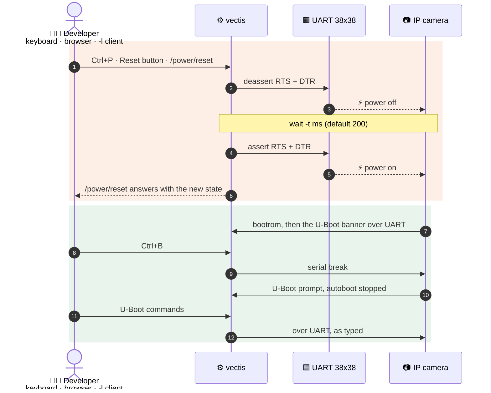
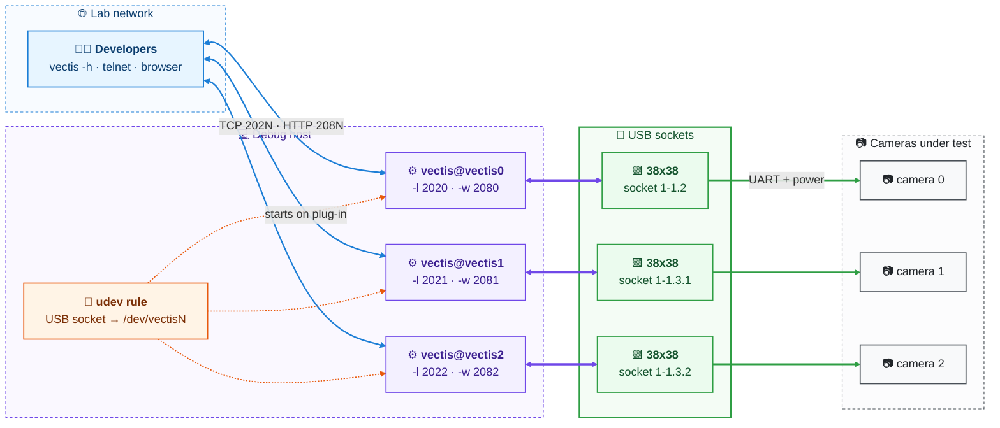

![OpenIPC logo][logo]

# OpenIPC Vectis

**English** | [Русский](README.ru.md) | [简体中文](README.zh-CN.md)

[](https://github.com/OpenIPC/vectis/actions/workflows/build.yml)
[](https://github.com/OpenIPC/vectis/releases/latest)
[](LICENSE)
[](https://github.com/OpenIPC/vectis)
[](#requirements)

Vectis is a serial console for fast debugging and device control during
development and integration of embedded systems with the OpenIPC UART
38x38 board. One small binary, `vectis`, plays three roles at once:

- **console** — bridges the keyboard to a serial port, either a local
  device (`-u /dev/ttyUSB0`) or one exposed by an RFC 2217 server
  (`-h HOST -p PORT`), with a reset pulse on RTS/DTR on `Ctrl+P` and a
  break on `Ctrl+B`;
- **server** — `-l PORT` serves the local port over TCP to telnet,
  another `vectis`, pyserial or nc, with Telnet/RFC 2217 negotiation,
  binary-safe data and out-of-band control of baud rate, line settings
  and RTS/DTR;
- **web** — `-w PORT` serves a power-control page (Enable / Disable /
  Reset on RTS+DTR) and a small JSON API for scripts.

It runs interactively in a terminal or as a daemon (`systemd`, no
terminal), reopens the device link on its own when an adapter is
unplugged, and needs nothing but libc.

With `-U` it drives a CH340/CH341 USB-UART adapter itself, from user
space through usbfs, for routers and other boards used as debug hosts
whose kernel has no `ch341` driver and cannot be rebuilt; see "USB mode
without a kernel driver" below.

<p align="center">
  
</p>

`vectis-bootrom.c`, the original UART bridge this program grew out of, is
kept in the repository for its HiSilicon boot-ROM catching extension; it
is described in [docs/vectis-bootrom.md](docs/vectis-bootrom.md) and is not part of
the default build.

## Quick start

On a Linux PC with the board plugged in, as a user in the `dialout` group:

```sh
# 1. Download the static binary
curl -fsSLO https://github.com/OpenIPC/vectis/releases/latest/download/vectis-linux-x86_64
install -m 755 vectis-linux-x86_64 vectis

# 2. The board's console: Ctrl+P = reset (power cycle), Ctrl+B = break, Ctrl+] = exit
./vectis -u /dev/ttyUSB0

# 3. Share it: the console on TCP port 2021, the power page on http://<this host>:8080/
./vectis -u /dev/ttyUSB0 -l 2021 -w 8080
```

From another machine `vectis -h <host> -p 2021` (or `telnet <host> 2021`)
opens that console, and `curl http://<host>:8080/power/reset` resets the
camera. On an OpenWrt router take `vectis-linux-mipsel`; if the router's
kernel has no driver for the adapter, give its USB path with `-U` instead of
`-u` (see "USB mode without a kernel driver"). Running vectis as a service
and several boards on one host are described below.

## Contents

- [Quick start](#quick-start)
- [Features](#features)
- [Requirements](#requirements)
- [Build](#build)
- [Releases and permanent links](#releases-and-permanent-links)
- [Hardware](#hardware)
- [How it fits together](#how-it-fits-together)
- [How it works](#how-it-works)
- [Usage](#usage)
- [Examples](#examples)
- [Session controls](#session-controls)
- [Non-interactive use](#non-interactive-use)
- [Serving the port over TCP (`-l`)](#serving-the-port-over-tcp--l)
- [Web power console (`-w`)](#web-power-console--w)
- [USB mode without a kernel driver (`-U`)](#usb-mode-without-a-kernel-driver--u)
- [Several adapters on one host: stable device names (udev)](#several-adapters-on-one-host-stable-device-names-udev)
- [Running vectis as a service (systemd)](#running-vectis-as-a-service-systemd)
- [vectis-bootrom.c: the original UART bridge](#vectis-bootromc-the-original-uart-bridge)
- [License](#license)
- [Support](#support)

## Features

- Local serial devices (`/dev/ttyUSB*`, `/dev/ttyS*`, `/dev/ttyACM*`) or
  RFC 2217 servers, configurable baud rate, data bits, stop bits, parity
- RTS and DTR asserted on connect, deasserted on exit; `Ctrl+P` reset
  pulse of configurable length on both lines
- `Ctrl+B` serial break (stops U-Boot autoboot)
- RFC 2217 client: `BINARY`, `SUPPRESS-GO-AHEAD`, `COM-PORT-OPTION`,
  `0xFF` escaping, port parameters and DTR/RTS over the wire, automatic
  reconnect (`-r`)
- RFC 2217 server (`-l`): one client at a time, raw mode for nc/socat,
  Telnet mode for telnet/pyserial/`vectis`, `SET-BAUDRATE`,
  `SET-DATASIZE`, `SET-PARITY`, `SET-STOPSIZE`, `SET-CONTROL`,
  `PURGE-DATA`, `SIGNATURE`, `BRK`
- Web power console (`-w`) with a JSON API: `/status`, `/power/enable`,
  `/power/disable`, `/power/reset`
- Daemon-friendly: no terminal required, listeners come up before the
  device link and stay up while it is away, one syslog line per outage
- Syslog logging of connections, power actions and errors

## Requirements

- Linux (glibc or musl); nothing but libc at run time
- A C99 compiler (GCC or Clang) and `make` to build
- Read/write access to the serial device, usually membership in the
  `dialout` group
- For `-U`: usbfs (`/dev/bus/usb`) and write access to
  the adapter's node there; no `ch341` or `usbserial` driver

## Build

```sh
make
```

This builds `vectis` (size-optimised and stripped) with `-U`.
`USB_CHIPS` lists the USB chip families for `-U`, all linked into the one
binary; the chip is picked by its USB VID:PID at run time, and `ch34x` is
the only one so far. `make USB=0` builds `vectis` without `-U` (tty and
RFC 2217 only). `make DEBUG=1` builds
with debug symbols and no optimisation instead. `make vectis-bootrom`
builds the original bridge on demand; `make all` does not.

Cross-compile by naming the toolchain:

```sh
# ARM, 32-bit
make clean
make CC=arm-linux-gnueabi-gcc STRIP=arm-linux-gnueabi-strip

# AArch64
make clean
make CC=aarch64-linux-gnu-gcc STRIP=aarch64-linux-gnu-strip
```

Run `make clean` when switching toolchains: Make compares only the
source and binary timestamps, so a different `CC` alone does not
rebuild a binary that is already there.

CI builds `vectis` and `vectis-bootrom` for x86_64, arm, aarch64 and
mipsel on every push and pull request, and checks that `make USB=0` builds; the binaries are
attached to each run as artifacts. On x86_64 it also runs the regression
tests, which need only Python 3 and use a pty in place of the serial
device:

```sh
make
python3 tests/test_vectis.py .
```

## Releases and permanent links

There is one release, [`latest`](https://github.com/OpenIPC/vectis/releases/latest).
CI rebuilds it from every push to `master` once all builds pass; its title carries
the version (`Vectis X.Y.Z`), and no versioned releases are kept. It holds static
musl binaries that run on any Linux of their architecture:
`vectis-linux-x86_64` for PCs and servers, `vectis-linux-mipsel` for MIPS
little-endian routers (MediaTek MT7620/MT7621/MT7628 and the like, OpenWrt),
soft-float, so it runs with or without an FPU. The file names carry no version, so
these links never change:

| What                  | Link                                                                             |
|-----------------------|----------------------------------------------------------------------------------|
| release page          | <https://github.com/OpenIPC/vectis/releases/latest>                              |
| `vectis-linux-x86_64` | <https://github.com/OpenIPC/vectis/releases/latest/download/vectis-linux-x86_64> |
| `vectis-linux-mipsel` | <https://github.com/OpenIPC/vectis/releases/latest/download/vectis-linux-mipsel> |

```sh
curl -fsSLO https://github.com/OpenIPC/vectis/releases/latest/download/vectis-linux-x86_64
chmod 755 vectis-linux-x86_64
```

The binaries of every new version are also posted to the OpenIPC Telegram channel ([our channels](https://openipc.org/our-channels)), for the archive and test downloads.

The release binaries are built with `ci/build-static.sh` (x86_64) and
`ci/build-mipsel.sh` (the OpenWrt 23.05.5 toolchain, downloaded once and checked by its
SHA256; needs curl, xz, make and qemu-mipsel), which also build them locally:

```sh
docker run --rm -v "$PWD":/src -w /src alpine:3.22 sh ci/build-static.sh
ci/build-mipsel.sh
```

The change history of every version is in [CHANGELOG.md](CHANGELOG.md).

Versions are `MAJOR.MINOR.PATCH` (`PROGRAM_VERSION` in `vectis.c`): PATCH for fixes and
small changes, MINOR for a new feature, MAJOR for an incompatible change or a large update,
only when the maintainer decides. A pull request that changes the code or the build (the
sources, the `Makefile`, `ci/`) raises the version as its last commit before the merge,
together with its `CHANGELOG.md` section. Changes to the docs, tests, screenshots or the
workflows in `.github/` do not. CI checks this on every pull request
(`.github/check-version.sh`).

## Hardware

The OpenIPC UART 38x38 board sits between the debug host and the device
under test: a USB-UART bridge for the device's console, and a power switch
in the device's supply line, driven by the bridge's RTS and DTR.

| Part             | Value                                                |
|------------------|------------------------------------------------------|
| Power switch     | up to 12 V, up to 300 mA                             |
| Switch control   | RTS and DTR together: both asserted = device powered |
| ALWAYS ON jumper | device powered all the time, the switch bypassed     |

- **Power switch.** The device under test is powered through it: up to
  12 V and 300 mA. A device that needs more must not be powered through the
  board.
- **ALWAYS ON jumper.** With the jumper set the board powers the device
  under test all the time, so power does not depend on software control.
  `Ctrl+P`, the web page and `/power/*` then do not switch the device off;
  vectis does not see the jumper, and `/status` keeps reporting the RTS+DTR
  state.

## How it fits together

```mermaid
flowchart LR
    subgraph REMOTE["🌐 Remote workstation"]
        direction TB
        T["⌨️ <b>Terminal</b><br/>vectis -h HOST -p 2021<br/>telnet · pyserial · nc"]
        B["🖱️ <b>Browser / curl</b><br/>http://HOST:8080"]
    end

    subgraph HOST["💻 Debug host · PC, router, dev board"]
        V["⚙️ <b>vectis</b><br/>-u /dev/ttyUSB0<br/>-l 2021 · -w 8080"]
    end

    subgraph BOARD["🟩 OpenIPC UART 38x38"]
        direction TB
        U["🔌 <b>USB-UART bridge</b>"]
        SW{{"⚡ <b>Power switch</b><br/>RTS + DTR"}}
    end

    subgraph DUT["📷 IP camera · device under test"]
        direction TB
        C["🖥️ <b>UART console</b><br/>bootrom · U-Boot · Linux"]
        P["🔋 <b>Power input</b>"]
    end

    PSU(["⚡ Power supply"])

    T <-->|"TCP/IP · Telnet / RFC 2217"| V
    B -->|"HTTP · Enable / Disable / Reset"| V
    V <==>|USB| U
    U <-->|"UART · TX / RX / GND"| C
    U -.->|"RTS + DTR · Ctrl+P, /power/*"| SW
    PSU ==> SW
    SW ==>|"switched power"| P

    classDef net   fill:#e7f5ff,stroke:#1c7ed6,color:#0b3d6e,stroke-width:1.5px
    classDef host  fill:#f3f0ff,stroke:#7048e8,color:#3b1f8f,stroke-width:1.5px
    classDef board fill:#ebfbee,stroke:#2f9e44,color:#14532d,stroke-width:1.5px
    classDef power fill:#fff4e6,stroke:#e8590c,color:#7a2e05,stroke-width:1.5px
    classDef cam   fill:#f8f9fa,stroke:#495057,color:#212529,stroke-width:1.5px
    class T,B net
    class V host
    class U board
    class SW,PSU,P power
    class C cam

    style REMOTE fill:#f8fbff,stroke:#1c7ed6,stroke-dasharray:4 3,color:#0b3d6e
    style HOST   fill:#faf8ff,stroke:#7048e8,stroke-dasharray:4 3,color:#3b1f8f
    style BOARD  fill:#f4fcf5,stroke:#2f9e44,stroke-width:2px,color:#14532d
    style DUT    fill:#fcfcfd,stroke:#495057,stroke-dasharray:4 3,color:#212529

    linkStyle 0,1 stroke:#1c7ed6,stroke-width:2px
    linkStyle 2 stroke:#7048e8,stroke-width:3px
    linkStyle 3 stroke:#2f9e44,stroke-width:2.5px
    linkStyle 4 stroke:#e8590c,stroke-width:2px
    linkStyle 5,6 stroke:#e03131,stroke-width:3px
```



| Line              | Link         | Carries                                                    |
|-------------------|--------------|------------------------------------------------------------|
| 🟦 blue           | TCP/IP, HTTP | the console over the network, power commands from the page |
| 🟪 purple, thick  | USB          | everything between the host and the board                  |
| 🟩 green          | UART         | TX, RX and GND to the camera's debug console               |
| 🟧 orange, dashed | RTS + DTR    | control of the power switch on the board                   |
| 🟥 red, thick     | power        | supply to the camera, switched by the board                |

### A reset, step by step



The power steps (orange) are the same whatever started them: a `Ctrl+P`
on the keyboard, the web page, `/power/reset`, or an RFC 2217
`SET-CONTROL` from a client on the `-l` port. The page shows a reset
started elsewhere, and `/status` names its source.

### RTS + DTR over time

```text
                            vectis    Disable   Enable    Reset           vectis
                            starts                       Ctrl+P           exits
                              │         │         │         │               │
 -u                           ┌─────────┐         ┌─────────┐    ┌──────────┐
 RTS+DTR    ──────────────────┘         └─────────┘         └────┘          └───────
                                                            ◄─t─►

 -U         ────────────────────────────┐         ┌─────────┐    ┌──────────────────
 RTS+DTR                                └─────────┘         └────┘

 high = RTS and DTR asserted = camera powered (the logical state, not the pin voltage)
 t    = reset pulse length, -t MS (default 200 ms)
```

- With `-u`, opening the tty asserts both lines and closing it drops them,
  so starting or restarting vectis power-cycles the camera.
- With `-U`, vectis sets the lines on start without dropping them first and
  leaves them as they are on exit, so a restart or an update of vectis
  does not touch the camera. Use `Ctrl+P` or `/power/reset` when a reset is
  wanted.

### A test bench with several cameras



Each board is named by the USB socket it is plugged into, not by the order
the kernel found it, and gets its own service instance with its own TCP
and web ports (`/etc/vectis/vectisN.conf`). Plugging a board into a known
socket starts its instance; unplugging it stops the instance. See
"Several adapters on one host" below.

## How it works

In RFC 2217 client mode `vectis` connects to a TCP server, puts the local terminal into raw mode,
and negotiates the following Telnet options with the server: `BINARY`, `SGA`,
and `COM-PORT-OPTION` (RFC 2217). After a short pause for the server's
negotiation replies it configures the remote serial port by sending `SET_BAUDRATE`, `SET_DATASIZE`,
`SET_STOPSIZE`, `SET_PARITY`, and `SET_CONTROL` sub-options (flow control
off, then DTR and RTS asserted). The server's replies are logged, so a
baud rate the server could not apply shows up as a different value in the
`server confirmed baud` line. The TCP socket uses a 10-second connect
timeout, `TCP_NODELAY` so keystrokes leave immediately, and keep-alive
probes that detect a silently dropped link within about 20 seconds.

The incoming byte stream is parsed as Telnet/RFC 2217: plain data bytes are
written to stdout, `IAC` sequences (`0xFF`) are intercepted and processed
separately, and escaped `0xFF 0xFF` pairs are unescaped to a single `0xFF`
before being forwarded to the terminal. Outgoing keyboard input is sent in
binary mode, with any `0xFF` bytes escaped as `IAC IAC` per RFC 854.

**Ctrl+P** sends a reset pulse to the target device: it issues `SET_CONTROL`
commands to drop DTR and RTS for a configurable duration (default 200 ms), then
reasserts them. In direct serial mode the same pulse is applied to the local
port via `ioctl(TIOCMBIC/TIOCMBIS)`. **Ctrl+B** sends a break: `IAC BRK` in
RFC 2217 mode, `tcsendbreak()` in direct serial mode.

In direct serial mode DTR and RTS are asserted when the device is opened and
deasserted again on exit, and the original termios settings are restored.

## Usage

```sh
./vectis -h <host> -p <port> [options]
./vectis -u <device> [options]
```

Every option also has a long form. Note that `-h` is the *host* option;
help is `--help` or `-?`.

RFC 2217/Telnet mode:

- `-h HOST`, `--host HOST` — RFC 2217 server address (name or IP, IPv4/IPv6)
- `-p PORT`, `--port PORT` — TCP port (`1..65535`)

Direct serial mode:

- `-u DEVICE`, `--device DEVICE` — local tty device path, for example `/dev/ttyUSB0`

USB mode (not in a `make USB=0` build):

- `-U SPEC`, `--usb SPEC` — USB-UART driven through usbfs; `SPEC` is the
  adapter's USB path (`1-1.3.4`, as in `/sys/bus/usb/devices`),
  `usb:VID:PID` (the first such device) or `usb:VID:PID@PATH`; see
  "USB mode without a kernel driver" below

The modes are mutually exclusive.

Port settings (default **115200 8N1**):

- `-b BAUD`, `--baud BAUD` — baud rate (default `115200`, maximum `921600`).
  Direct serial mode accepts the standard rates `300`, `1200`, `2400`,
  `4800`, `9600`, `19200`, `38400`, `57600`, `115200`, `230400`, `460800`
  and `921600`; RFC 2217 mode passes the value to the server as is.
- `-d 5|6|7|8`, `--data-bits N` — data bits (default 8)
- `-s 1|2`, `--stop-bits N` — stop bits (default 1)
- `-y N|E|O`, `--parity X` — parity None/Even/Odd (default N)

Connection options:

- `-r`, `--reconnect` — reconnect automatically on disconnect, retrying
  every 5 seconds (RFC 2217 mode only; with `-l` or `-w` the link is
  reopened automatically in both modes without this flag)
- `-t MS`, `--reset-ms MS` — reset pulse duration in milliseconds,
  `1..60000` (default 200)
- `-n`, `--no-crlf` — disable LF→CR+LF translation (for devices that already send `\r\n`, or for binary capture)
- `-l [ADDR:]PORT`, `--listen [ADDR:]PORT` — serve the local port (`-u`, `-U`)
  to one TCP client at a time: telnet, another `vectis -h HOST -p PORT`,
  pyserial `rfc2217://`, or raw nc/socat; see "Serving the port over TCP"
  below
- `-w [ADDR:]PORT`, `--web [ADDR:]PORT` — start the built-in web power
  console on that port (all interfaces unless an IPv4 address is given);
  see "Web power console" below
- `-v`, `--version` — print version and release date
- `--help`, `-?` — help

## Examples

```sh
# 115200 8N1 — all parameters at their defaults
./vectis -h 192.168.1.10 -p 7000

# 9600 8E1
./vectis -h 192.168.1.10 -p 7000 -b 9600 -y E

# Auto-reconnect on disconnect
./vectis -h 192.168.1.10 -p 7000 -r

# Direct serial device at 115200
./vectis -u /dev/ttyUSB0

# Direct serial device at 460800 baud, 500 ms reset pulse
./vectis -u /dev/ttyUSB0 -b 460800 -t 500

# Capture device output to a file (non-interactive, no CRLF translation)
./vectis -h 192.168.1.10 -p 7000 -n > boot.log

# Serial console plus the web power console on http://<this host>:8080/
./vectis -u /dev/ttyUSB0 -w 8080

# One process for everything: local console, UART served on TCP 2021, web on 2081
./vectis -u /dev/ttyUSB0 -l 2021 -w 2081
```

## Session controls

These key bindings are active only in interactive mode (when stdin is a
terminal). In non-interactive mode (piped or redirected stdin), all bytes
are forwarded to the device verbatim, so control characters in the data
stream are never misinterpreted as commands.

| Key      | Action                                                                 |
|----------|------------------------------------------------------------------------|
| `Ctrl+P` | RTS+DTR pulse — reset the target device                                |
| `Ctrl+B` | Send break signal — stops U-Boot autoboot, triggers bootloader prompts |
| `Ctrl+]` | Exit                                                                   |

`Ctrl+C` is passed to the device like any other byte; use `Ctrl+]` to
quit. Sending `SIGINT` or `SIGTERM` from elsewhere also ends the session
cleanly. If the controlling terminal disappears, `vectis` exits on its
own.

`Ctrl+]` also works while the device link is down and `vectis` is
waiting to reconnect (`-r`, `-l`, `-w`). Other keys typed meanwhile are
discarded rather than sent to the device in one burst when the link
comes back.

The reset pulse does not stop the program: while RTS and DTR are low,
device output keeps flowing, and the keyboard, the `-l` client and the
web page stay responsive. A second `Ctrl+P` during a pulse is ignored.

## Non-interactive use

When stdin is not a terminal, `vectis` skips raw-terminal setup and
forwards all input directly to the device. Once stdin reaches EOF the
input side is finished, but the device's reply may still be on its way,
so `vectis` stops reading stdin and keeps forwarding device output to
stdout until the connection closes or it receives a signal. Bound a
scripted session with `timeout`:

```sh
# Send a U-Boot command and capture the response for 3 seconds
echo "printenv" | timeout 3 ./vectis -h 192.168.1.10 -p 7000 -n > env.txt

# Feed a sequence of commands from a file, collect output for 10 seconds
timeout 10 ./vectis -u /dev/ttyUSB0 < commands.txt > output.txt
```

Status messages go to stderr and to syslog, so stdout carries only the
device's data.

## Serving the port over TCP (`-l`)

`-l PORT` (or `-l ADDR:PORT`) turns a direct-serial session into a small
RFC 2217 server for the same port, so one `vectis` process can be the
local console, the network access point and, with `-w`, the web power
console at once:

```sh
./vectis -u /dev/ttyUSB0 -l 2021 -w 2081
```

Clients that work against it:

```sh
vectis -h 192.168.1.20 -p 2021          # another vectis, with Ctrl+P / Ctrl+B
telnet 192.168.1.20 2021                    # binary data path, "send brk" at the escape prompt
python3 -c "import serial; s = serial.serial_for_url('rfc2217://192.168.1.20:2021'); s.dtr = False"
socat -,raw,echo=0 TCP:192.168.1.20:2021    # raw mode, Ctrl+P resets the target
nc 192.168.1.20 2021                        # raw mode, line by line
```

The behaviour mirrors the original `vectis-bootrom` server:

- One client at a time; a new connection replaces the current one.
- A connection starts in **legacy raw mode**: bytes pass through, `LF`
  and `CR LF` become `CR` so Enter reaches U-Boot, and `Ctrl+P` (`0x10`)
  fires the reset pulse. No echo is added.
- The first Telnet `IAC` byte from the client switches the connection to
  **Telnet/RFC 2217 mode** for good: `BINARY`, `SUPPRESS-GO-AHEAD` and
  `COM-PORT-OPTION` are negotiated, `0xFF` is escaped in both directions,
  and `Ctrl+P` is no longer intercepted (the data path is binary safe).
- In Telnet mode the client can change the local port: `SET-BAUDRATE`
  (standard rates up to 921600), `SET-DATASIZE` (5..8), `SET-PARITY`
  (none/odd/even), `SET-STOPSIZE` (1 or 2), `PURGE-DATA`, and drive DTR
  and RTS with `SET-CONTROL`; each reply reports the value actually in
  effect. An empty `SIGNATURE` request is answered with
  `vectis <version>`; a client's own signature is logged, not
  answered. A Telnet `BRK` sends a serial break. The HiSilicon `BOOTROM-CATCH` extension of
  `vectis-bootrom` is not implemented here.
- Everything the client does is logged with its address, and the web
  page and `/status` show the connected client.
- EOF from the client ends the session, as on `vectis-bootrom`. That
  is what `nc` does when its stdin runs out (`echo cmd | nc host 2021`),
  so for scripted one-shot commands prefer `vectis -h host -p 2021`
  or `socat`, which keep the connection open.

The local terminal, the web console and the TCP client all drive the same
port side by side: device output goes to all of them, input from any of
them goes to the device, and a power action from one is visible to the
others. If the device link drops, the listener stays up, clients can
connect and negotiate, their data is discarded until the link is back,
and the port is reopened with the command-line settings. Like `-w`, `-l`
makes the process reopen the link automatically; it requires `-u`.

## Web power console (`-w`)

<p align="center">
  
</p>

<p align="center"><sub>vectis 1.6.1 running on an OpenIPC Dev Board, serving its <code>/dev/ttyUSB0</code> with <code>-w 8080 -l 2021 -t 300</code>; a second <code>vectis</code> is connected to the <code>-l</code> port.</sub></p>

`-w PORT` (or `-w ADDR:PORT` to listen on one IPv4 address only) starts a
built-in web server alongside the terminal session. It serves a single
page, styled as a brass-and-rivets control panel with the heading
**Vectis Web Server**, carrying three latching buttons:

| Button    | Action                                                         | Indicator                                       |
|-----------|----------------------------------------------------------------|-------------------------------------------------|
| `Enable`  | assert RTS+DTR (device powered)                                | lit while power is on                           |
| `Disable` | deassert RTS+DTR (device unpowered)                            | lit while power is off                          |
| `Reset`   | RTS+DTR pulse of `-t` milliseconds, exactly what `Ctrl+P` does | lit, with a spinning gear, while the pulse runs |

A press animates the button, the lamps (link, RTS+DTR) and a gauge
needle follow the device state, and the page polls that state every
two seconds, so a `Ctrl+P` from the keyboard or a press in another
browser shows up too. The buttons use the very same transport as the
terminal session: `ioctl` on the local port in `-u` mode, `SET-CONTROL`
over RFC 2217 in `-h`/`-p` mode. The terminal session, hotkeys and all
other behaviour are unchanged and keep working side by side with the
page.

With `-w` the web server is listening before the device link is opened,
and the link is (re)established automatically whenever it fails or drops,
in both modes, so the page is reachable immediately and stays up while a
camera is unplugged or the server restarts. Meanwhile the page reports
`Link offline` and the buttons refuse to act. Only the first failure of
an outage is logged.

Everything the page does is available as plain URLs, so `curl`, a shell
script or a browser bookmark can drive the device the same way:

| URL              | Method      | Action                                 | Reply            |
|------------------|-------------|----------------------------------------|------------------|
| `/`              | GET         | the page                               | HTML             |
| `/status`        | GET         | current state                          | JSON             |
| `/power/enable`  | GET or POST | assert RTS+DTR                         | JSON, full state |
| `/power/disable` | GET or POST | deassert RTS+DTR                       | JSON, full state |
| `/power/reset`   | GET or POST | RTS+DTR pulse; answers when it is over | JSON, full state |

The reset pulse runs in the background: while it lasts, `/status`, the
other pages, the terminal and the `-l` client are served as usual, and
a second `/power/reset` joins the pulse already running. Up to six
`/power/reset` requests wait for the end of the pulse; further ones are
answered at once with the current state, so the page and `/status`
always find a free connection slot. A client that shuts down its
sending side after the request (`nc -N`) still gets the reply. An
`/power/enable`, `/power/disable` or an RFC 2217 `SET-CONTROL` during
the pulse ends it: the lines stay as that command set them, and a
waiting `/power/reset` is answered with that state at once. If the
link drops during the pulse, `/power/reset` answers `503`.

```sh
curl -s http://192.168.1.20:8080/status
curl -s http://192.168.1.20:8080/power/reset
```

```json
{"link":"online","mode":"serial","target":"/dev/ttyUSB0","power":"on",
 "rts":1,"dtr":1,"reset_ms":200,"tcp_client":"192.168.1.5",
 "event":{"seq":7,"kind":"reset","source":"rfc2217","ago_ms":1830},
 "version":"1.7.0"}
```

`link` is `online` or `offline`, `power` is the state last commanded by
this process, `rts`/`dtr` are the real modem bits in `-u` mode and the
state last set in `-U` mode (`-1` when unavailable or in RFC 2217 mode), `tcp_client` is the address of
the `-l` client or `null`, and `event` is the last change of the power
lines from any side: `kind` is `on`, `off` or `reset` (an off followed by
an on within 5 seconds from the same source), `source` is `web`,
`keyboard`, `tcp` (raw client, `Ctrl+P`), `rfc2217` (`SET-CONTROL` from a
Telnet client) or `link` (asserted when the port was opened), `seq`
grows with every event and `ago_ms` says how long ago it happened. The
page uses it to show a reset that was triggered elsewhere: a `Ctrl+P`
from the keyboard or from a `vectis -h HOST -p PORT` client makes the
Reset button light up and the needle swing, and the log line names the
source. A bare `telnet` sends `Ctrl+P` as data, so nothing happens on
the device or on the page in that case. The command URLs answer JSON to
every client, a browser included, so `/power/reset` opened from a
bookmark shows the resulting state as text. The page is served only for
a bare `/`; anything appended to it answers `404`. While the link is
down the `/power/` commands answer `503`; an unknown command answers
`404`. Query strings on the command URLs are ignored.

There is no authentication. Bind the console to a trusted interface
(`-w 127.0.0.1:8080`) or keep the port inside the lab network, as with
the `-l` listener.

```sh
# Serial adapter, web console on every interface, port 8080
./vectis -u /dev/ttyUSB0 -w 8080

# Headless: no terminal, device output to a log, console on localhost only
./vectis -h 192.168.1.10 -p 35240 -w 127.0.0.1:8080 -n < /dev/null > uart.log 2>&1 &
```

## USB mode without a kernel driver (`-U`)

`vectis -U` drives a CH340/CH341 adapter itself, through the
kernel's usbfs interface, with no `ch341` or `usbserial` driver. Use it
only on hosts whose kernel lacks the driver and cannot be rebuilt:
routers and other boards used as debug hosts. Everywhere else, desktop
Linux, macOS and Windows included, use the standard driver and
`-u /dev/ttyUSB0`.

```sh
./vectis -U 1-1.3.4 -l 2021 -w 2081      # by USB path
./vectis -U usb:1a86:7523                # the first CH340 found
```

Everything works as with `-u`: the console, `-l`, `-w`, `Ctrl+P`,
`Ctrl+B`, RFC 2217 control of the baud rate, line settings and RTS/DTR,
reopening the link after the adapter is lost. The differences:

- **RTS/DTR survive a restart.** With `-u` the kernel drops both lines
  when the tty is closed, so restarting vectis power-cycles the target.
  With `-U` vectis leaves the lines as they are on exit and sets them on
  start without dropping them first, so an update or a restart of vectis
  does not reset the device. Use `/power/reset` or `Ctrl+P` when a reset
  is wanted.
- **Taking the adapter from the kernel driver resets once.** If `ch341`
  is bound to the adapter, vectis detaches it, and the kernel drops the
  lines at that moment. The driver stays detached until the adapter is
  replugged or the host reboots; `/dev/ttyUSB*` of that adapter is gone
  meanwhile.
- **No tty for other programs.** While vectis holds the adapter,
  minicom, picocom or pyserial cannot open it: connect them to the `-l`
  port instead (`rfc2217://HOST:PORT` in pyserial).
- `rts`/`dtr` in `/status` show the state last set: the chip cannot
  report its outputs.
- CH340/CH341 only (`1a86:7523`, `1a86:7522`, `1a86:5523` and the IDs
  the Linux `ch341` driver knows); Linux only. Checked on chip version
  0x31; chips older than 0x30 work at 8N1 only and are initialised on
  every start, so their lines may drop on a restart (vectis logs a
  warning).

The host needs a kernel with USB host support and usbfs (`/dev/bus/usb`,
created by devtmpfs); `ch341` and `usbserial` are not needed. The user
that runs vectis needs read and write access to the adapter's node
`/dev/bus/usb/BBB/DDD`. Root has it; for another user add a udev rule.
The node gets a new number on every replug, so match the USB path:

```sh
sudo tee /etc/udev/rules.d/71-vectis-usb.rules >/dev/null <<'EOF'
# vectis -U: raw USB access to the CH340 at USB path 1-1.3.4 for the dialout group
SUBSYSTEM=="usb", ENV{DEVTYPE}=="usb_device", ATTR{idVendor}=="1a86", KERNEL=="1-1.3.4", GROUP="dialout", MODE="0660"
EOF
sudo udevadm control --reload
sudo udevadm trigger --action=change /sys/bus/usb/devices/1-1.3.4
```

and add the user to `dialout` (`sudo usermod -aG dialout USER`, effective
at the next login). Detaching the kernel driver needs no more than write
access to the node. On OpenWrt and similar systems without udev the
daemon usually runs as root and needs nothing more.

## Several adapters on one host: stable device names (udev)

`/dev/ttyUSB0`, `/dev/ttyUSB1`, ... are numbered in the order the kernel
finds the adapters, which changes with the plugging order, with other USB
devices coming and going, and from one boot to the next. A daemon started
with `-u /dev/ttyUSB0` can silently end up on a different board. Bind the
names to something that does not move instead.

Adapters with a factory serial number (FTDI, CP210x, CH343/CH9102) get a
stable name in `/dev/serial/by-id/` automatically; use that path with
`-u` and nothing else is needed. CH340 adapters (`1a86:7522`, `1a86:7523`
and clones) have no serial number, so several of them collapse into one
`by-id` entry. For those, bind the name to the **physical USB socket**
with a udev rule. Worked example with five CH340 adapters, one in a
socket of the PC and four on a USB hub:

1. Look at the topology udev already knows. The number after the last
   dot before `:1.0` is the port on the last hub in the chain:

   ```sh
   ls -l /dev/serial/by-path/
   # pci-0000:00:1d.0-usb-0:1.2:1.0-port0   -> ../../ttyUSB1   (port 2 of the built-in hub)
   # pci-0000:00:1d.0-usb-0:1.3.2:1.0-port0 -> ../../ttyUSB2   (port 2 of the external hub on port 3)
   # pci-0000:00:1d.0-usb-0:1.3.3:1.0-port0 -> ../../ttyUSB0   (port 3 of that hub)
   ```

   (`usbv2-...` entries are the same links under a newer naming scheme.)

2. Get the kernel names of the same ports, the values for `KERNELS==`:

   ```sh
   for d in /dev/ttyUSB*; do echo -n "$d  "; udevadm info -q property -n $d | grep -oP 'DEVPATH=.*/\K[0-9.-]+(?=:1\.0/)'; done
   # /dev/ttyUSB0  1-1.3.3
   # /dev/ttyUSB1  1-1.2
   # /dev/ttyUSB2  1-1.3.2
   ```

   To learn which socket is which, unplug one adapter, run the command
   again and see which line disappeared; then label the socket.

3. Write the rule, one line per socket, `/etc/udev/rules.d/99-vectis-boards.rules`:

   ```
   SUBSYSTEM=="tty", ATTRS{idVendor}=="1a86", ATTRS{idProduct}=="7522", KERNELS=="1-1.2",   SYMLINK+="vectis0", GROUP="dialout", MODE="0660", TAG+="systemd", ENV{SYSTEMD_WANTS}+="vectis@vectis0.service"
   SUBSYSTEM=="tty", ATTRS{idVendor}=="1a86", ATTRS{idProduct}=="7522", KERNELS=="1-1.3.1", SYMLINK+="vectis1", GROUP="dialout", MODE="0660", TAG+="systemd", ENV{SYSTEMD_WANTS}+="vectis@vectis1.service"
   SUBSYSTEM=="tty", ATTRS{idVendor}=="1a86", ATTRS{idProduct}=="7522", KERNELS=="1-1.3.2", SYMLINK+="vectis2", GROUP="dialout", MODE="0660", TAG+="systemd", ENV{SYSTEMD_WANTS}+="vectis@vectis2.service"
   SUBSYSTEM=="tty", ATTRS{idVendor}=="1a86", ATTRS{idProduct}=="7522", KERNELS=="1-1.3.3", SYMLINK+="vectis3", GROUP="dialout", MODE="0660", TAG+="systemd", ENV{SYSTEMD_WANTS}+="vectis@vectis3.service"
   SUBSYSTEM=="tty", ATTRS{idVendor}=="1a86", ATTRS{idProduct}=="7522", KERNELS=="1-1.3.4", SYMLINK+="vectis4", GROUP="dialout", MODE="0660", TAG+="systemd", ENV{SYSTEMD_WANTS}+="vectis@vectis4.service"
   ```

   Each line does two things: it names the port (`SYMLINK+=`) and it
   tells systemd to start the matching service instance whenever the
   port appears (`TAG+="systemd"`, `SYSTEMD_WANTS`). `ATTRS{idVendor}`
   and `ATTRS{idProduct}` come from `lsusb`; keep them so the rule never
   renames a keyboard that happens to sit in that socket. Sockets that
   are empty today (`1-1.3.1`, `1-1.3.4` above) may be listed in
   advance: nothing happens until an adapter is plugged in there.

4. Apply and check:

   ```sh
   udevadm control --reload && udevadm trigger --subsystem-match=tty --action=change && udevadm settle
   ls -l /dev/vectis*
   # /dev/vectis0 -> ttyUSB1
   # /dev/vectis2 -> ttyUSB2
   # /dev/vectis3 -> ttyUSB0
   ```

5. Use the names everywhere: interactively `vectis -u /dev/vectis3`,
   and for the daemons the template service below, one instance per
   adapter, started and stopped by the device itself.

Notes:

- With hubs behind hubs, use the full path. A wildcard such as
  `KERNELS=="*.2"` would match both `1-1.2` and `1-1.3.2`.
- The path includes the socket the hub itself is plugged into: moving the
  hub from `1-1.3` to another socket changes `1-1.3.x` for every adapter
  on it, and the rule must be edited. Adapters plugged straight into the
  PC depend only on their own socket.
- Mixing adapter models is an alternative: `by-id` tells a CH340, a
  CP2102 and an FTDI apart by vendor and product id even without serial
  numbers. Only identical serial-less adapters need the rule above.

### One service instance per adapter, started by the device

With the rule above the daemons need no `systemctl enable` at all. A
template unit `vectis@.service` describes one instance; udev starts
`vectis@vectisN` when `/dev/vectisN` appears (at boot or on hot-plug)
and `BindsTo=` stops it when the adapter is pulled. As many adapters
are plugged into known sockets, as many instances run.

```ini
# /etc/systemd/system/vectis@.service  — instance %i = vectis0, vectis1, ...
[Unit]
Description=Vectis console on /dev/%i
BindsTo=dev-%i.device
After=dev-%i.device network.target

[Service]
Type=simple
EnvironmentFile=/etc/vectis/%i.conf
ExecStart=/usr/local/bin/vectis -u /dev/%i -b ${BAUD} -t ${RESET_MS} -l ${TCP_PORT} -w ${WEB_PORT} -n
StandardInput=null
StandardOutput=journal
StandardError=journal
Restart=on-failure
RestartSec=5
User=vectis
SupplementaryGroups=dialout
NoNewPrivileges=yes
ProtectSystem=strict
ProtectHome=yes
PrivateTmp=yes
```

There is deliberately no `[Install]` section: the device is the only
thing that starts an instance. Every adapter needs its own settings
file, because the TCP and web ports must differ between instances; an
instance whose file is missing fails to start and says so in the
journal.

```sh
# /etc/vectis/vectis3.conf — one file per adapter, name = the udev link
BAUD=115200
RESET_MS=300
TCP_PORT=2023
WEB_PORT=2083
```

Put everything in place, then let udev re-evaluate the ports that are
already plugged in:

```sh
sudo install -m 755 vectis /usr/local/bin/
sudo useradd --system --no-create-home --shell /usr/sbin/nologin vectis
sudo mkdir -p /etc/vectis          # one vectisN.conf per adapter
sudo systemctl daemon-reload
sudo udevadm control --reload && sudo udevadm trigger --subsystem-match=tty --action=change && udevadm settle
systemctl list-units 'vectis@*'    # one active instance per plugged adapter
journalctl -u vectis@vectis3 -f
curl -s http://127.0.0.1:2083/status
```

From then on plugging an adapter into a known socket starts its
instance, unplugging it stops the instance, and a reboot brings up
exactly the adapters that are present.

## Running vectis as a service (systemd)

`vectis` needs no terminal: with stdin closed it keeps forwarding the
device output (to the journal here), the listeners stay up, and the
device link is reopened automatically if the adapter goes away. For
several adapters use the device-started template from the previous
section. For a single adapter a plain unit is enough; this one serves
the adapter named `/dev/vectis1` by the udev rule above on TCP port
2021, with the web console on port 2081 and a 300 ms reset pulse:

```ini
# /etc/systemd/system/vectis.service
[Unit]
Description=Vectis serial console: UART on TCP 2021, web power control on 2081
After=network.target

[Service]
Type=simple
ExecStart=/usr/local/bin/vectis -u /dev/vectis1 -b 115200 -t 300 -l 2021 -w 2081
# Device output goes to the journal; status messages are on stderr and in syslog
StandardInput=null
StandardOutput=journal
StandardError=journal
Restart=on-failure
RestartSec=5
# An unprivileged user in the group that owns the port (dialout, as set by the udev rule)
User=vectis
SupplementaryGroups=dialout
# Hardening
NoNewPrivileges=yes
ProtectSystem=strict
ProtectHome=yes
PrivateTmp=yes

[Install]
WantedBy=multi-user.target
```

```sh
sudo install -m 755 vectis /usr/local/bin/
sudo useradd --system --no-create-home --shell /usr/sbin/nologin vectis
sudo systemctl daemon-reload
sudo systemctl enable --now vectis
systemctl status vectis
journalctl -u vectis -f          # device output and status messages
curl -s http://127.0.0.1:2081/status
vectis -h 127.0.0.1 -p 2021      # interactive console through the service
```

`systemctl stop` sends `SIGTERM`, which `vectis` handles by
deasserting RTS/DTR and restoring the port before exiting. Add `-n` to
`ExecStart` if the journal shows stray `CR` characters: the LF→CR+LF
translation exists for raw terminals, not for log files. The unit is
not bound to the device on purpose: the daemon starts at boot even when
the adapter is absent, the web page shows `Link offline` and the link is
opened as soon as the adapter appears. `/dev/vectis1` comes from the
udev rule in the previous section; without such a rule use a
`/dev/serial/by-id/...` path, or `/dev/ttyUSB0` for a single adapter. For the RFC 2217
client mode replace `-u /dev/ttyUSB0` with `-h HOST -p PORT`, drop `-l`
and the `.device` lines.

## vectis-bootrom.c: the original UART bridge

`vectis-bootrom.c` is the program this repository started with: a UART
terminal and TCP bridge for the OpenIPC UART 38x38 board with the same
RTS/DTR reset pulse, later extended with RFC 2217 auto-detection on its
TCP listener, inetd/inittab integration, and a vendor extension,
`BOOTROM-CATCH`, that runs the HiSilicon boot-ROM `0x20`-marker /
`0xAA`-ack handshake next to the UART so it works over links with high
round-trip time. Everything else it did is now covered by `vectis`
(`-u` for the console, `-l` for the TCP side, `-w` for power control),
so the file is kept for reference and for that boot-ROM extension. It is
not built by default:

```sh
make vectis-bootrom        # or: cc -std=gnu99 -Os -o vectis-bootrom vectis-bootrom.c
```

Its options, hotkeys, the RFC 2217 mode with the `BOOTROM-CATCH` extension
and the inetd/inittab setups are in [docs/vectis-bootrom.md](docs/vectis-bootrom.md).

## License

[MIT](LICENSE). See [LICENSE](LICENSE) for the full terms.

## Support

- Questions and bug reports: [GitHub Issues](https://github.com/OpenIPC/vectis/issues)
- Documentation: [openipc.org](https://openipc.org)

[](https://openipc.org/our-channels)

[logo]: https://raw.githubusercontent.com/OpenIPC/.github/refs/heads/main/assets/openipc-logo-black.svg
