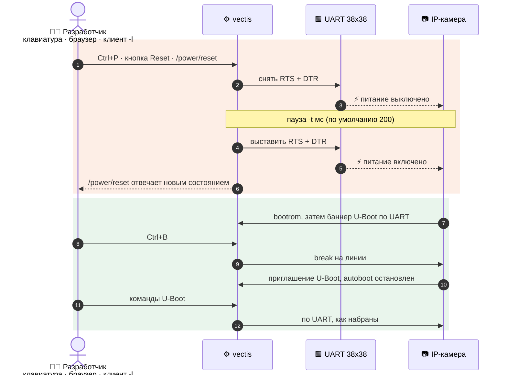
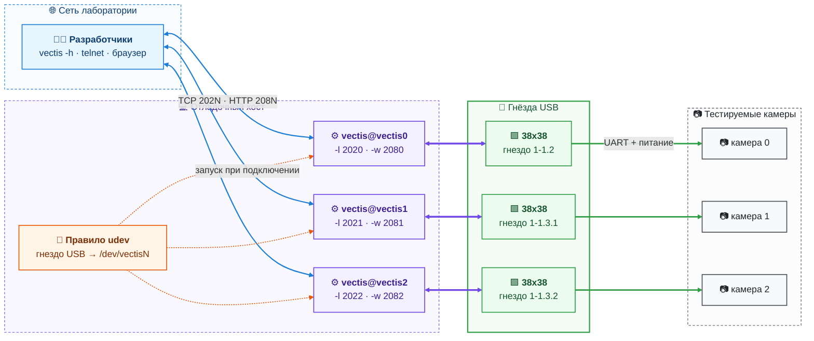

![OpenIPC logo][logo]

# OpenIPC Vectis

[English](README.md) | **Русский** | [简体中文](README.zh-CN.md)

[](https://github.com/OpenIPC/vectis/actions/workflows/build.yml)
[](https://github.com/OpenIPC/vectis/releases/latest)
[](LICENSE)
[](https://github.com/OpenIPC/vectis)
[](#требования)

Vectis — последовательная консоль для быстрой отладки и управления
устройствами при разработке и интеграции встраиваемых систем с платой
OpenIPC UART 38x38. Один небольшой бинарный файл, `vectis`, выполняет сразу
три роли:

- **консоль** — связывает клавиатуру с последовательным портом: локальным
  устройством (`-u /dev/ttyUSB0`) или портом, который предоставляет сервер
  RFC 2217 (`-h HOST -p PORT`); по `Ctrl+P` подаёт импульс сброса на RTS/DTR,
  по `Ctrl+B` — сигнал break;
- **сервер** — `-l PORT` отдаёт локальный порт по TCP для telnet, другого
  `vectis`, pyserial или nc — с согласованием Telnet/RFC 2217, прозрачной
  передачей двоичных данных и внеполосным управлением скоростью,
  параметрами линии и RTS/DTR;
- **веб** — `-w PORT` отдаёт страницу управления питанием (Enable / Disable /
  Reset через RTS+DTR) и небольшой JSON API для скриптов.

Программа работает интерактивно в терминале или как демон (`systemd`, без
терминала), сама заново открывает связь с устройством, если адаптер
отключили, и не требует ничего, кроме libc.

С `-U` он сам управляет USB-UART адаптером CH340/CH341 из пространства
пользователя через usbfs — для роутеров и других плат-отладчиков, в ядре
которых нет драйвера `ch341` и пересобрать его нельзя; см. «Режим USB без
драйвера ядра» ниже.

<p align="center">
  
</p>

`vectis-bootrom.c`, исходный UART-мост, из которого выросла эта программа,
сохранён в репозитории ради расширения для перехвата boot ROM HiSilicon; он
описан в [docs/vectis-bootrom.md](docs/vectis-bootrom.md) и в сборку по умолчанию
не входит.

## Быстрый старт

На ПК с Linux с подключённой платой, от пользователя из группы `dialout`:

```sh
# 1. Скачать статический бинарный файл
curl -fsSLO https://github.com/OpenIPC/vectis/releases/latest/download/vectis-linux-x86_64 &&
  install -m 755 vectis-linux-x86_64 vectis

# 2. Консоль платы: Ctrl+P — сброс (перезапуск питания), Ctrl+B — break, Ctrl+] — выход
./vectis -u /dev/ttyUSB0

# 3. Открыть доступ: консоль на TCP-порту 2021, страница питания на http://<этот хост>:8080/
./vectis -u /dev/ttyUSB0 -l 2021 -w 8080
```

С другой машины эту консоль открывает `vectis -h <host> -p 2021` (или
`telnet <host> 2021`), а `curl http://<host>:8080/power/reset` перезапускает
камеру. На роутере с OpenWrt берите `vectis-linux-mipsel`; если в ядре роутера
нет драйвера для адаптера, укажите его путь USB с `-U` вместо `-u` (см. «Режим
USB без драйвера ядра»). Запуск vectis как службы и несколько плат на одном
хосте описаны ниже.

## Содержание

- [Быстрый старт](#быстрый-старт)
- [Возможности](#возможности)
- [Требования](#требования)
- [Сборка](#сборка)
- [Релизы и постоянные ссылки](#релизы-и-постоянные-ссылки)
- [Оборудование](#оборудование)
- [Как всё связано](#как-всё-связано)
- [Как это работает](#как-это-работает)
- [Использование](#использование)
- [Примеры](#примеры)
- [Управление сеансом](#управление-сеансом)
- [Неинтерактивный режим](#неинтерактивный-режим)
- [Доступ к порту по TCP (`-l`)](#доступ-к-порту-по-tcp--l)
- [Веб-консоль управления питанием (`-w`)](#веб-консоль-управления-питанием--w)
- [Режим USB без драйвера ядра (`-U`)](#режим-usb-без-драйвера-ядра--u)
- [Несколько адаптеров на одном хосте: постоянные имена устройств (udev)](#несколько-адаптеров-на-одном-хосте-постоянные-имена-устройств-udev)
- [Запуск vectis как службы (systemd)](#запуск-vectis-как-службы-systemd)
- [vectis-bootrom.c: исходный UART-мост](#vectis-bootromc-исходный-uart-мост)
- [Лицензия](#лицензия)
- [Поддержка](#поддержка)

## Возможности

- Локальные последовательные устройства (`/dev/ttyUSB*`, `/dev/ttyS*`, `/dev/ttyACM*`)
  или серверы RFC 2217; настраиваемые скорость, число бит данных, стоп-биты, чётность
- RTS и DTR выставляются при подключении и снимаются при выходе; по `Ctrl+P` —
  импульс сброса настраиваемой длительности на обеих линиях
- `Ctrl+B` — сигнал break в последовательную линию (останавливает автозагрузку U-Boot)
- Клиент RFC 2217: `BINARY`, `SUPPRESS-GO-AHEAD`, `COM-PORT-OPTION`,
  экранирование `0xFF`, передача параметров порта и DTR/RTS по сети,
  автоматическое переподключение (`-r`)
- Сервер RFC 2217 (`-l`): один клиент одновременно, режим raw для nc/socat,
  режим Telnet для telnet/pyserial/`vectis`, `SET-BAUDRATE`,
  `SET-DATASIZE`, `SET-PARITY`, `SET-STOPSIZE`, `SET-CONTROL`,
  `PURGE-DATA`, `SIGNATURE`, `BRK`
- Веб-консоль управления питанием (`-w`) с JSON API: `/status`, `/power/enable`,
  `/power/disable`, `/power/reset`
- Удобство работы в роли демона: терминал не нужен, слушающие сокеты поднимаются
  раньше связи с устройством и продолжают работать, пока её нет, на каждый
  обрыв — одна строка в syslog
- Запись в syslog подключений, действий с питанием и ошибок

## Требования

- Linux (glibc или musl); во время работы не нужно ничего, кроме libc
- Для сборки — компилятор C99 (GCC или Clang) и `make`
- Права на чтение и запись последовательного устройства, обычно — членство
  в группе `dialout`
- Для `-U`: usbfs (`/dev/bus/usb`) и право записи в узел
  адаптера там; драйверы `ch341` и `usbserial` не нужны

## Сборка

```sh
make
```

Собирается `vectis` с `-U` (с оптимизацией по размеру, без отладочных
символов). `USB_CHIPS` перечисляет семейства USB-микросхем для `-U`, все
они входят в один бинарный файл; микросхема выбирается при запуске по её
USB VID:PID, пока есть только `ch34x`. `make USB=0` собирает `vectis` без
`-U` (только tty и RFC 2217).
`make DEBUG=1` вместо этого собирает с отладочными символами и без
оптимизации. `make vectis-bootrom` собирает исходный мост по запросу;
`make all` его не собирает.

Для кросс-компиляции укажите тулчейн:

```sh
# ARM, 32 бита
make clean
make CC=arm-linux-gnueabi-gcc STRIP=arm-linux-gnueabi-strip

# AArch64
make clean
make CC=aarch64-linux-gnu-gcc STRIP=aarch64-linux-gnu-strip
```

При смене тулчейна выполняйте `make clean`: Make сравнивает только
время изменения исходника и бинарника, поэтому другой `CC` сам по себе
не пересоберёт уже существующий бинарный файл.

CI собирает `vectis` и `vectis-bootrom` для x86_64, arm, aarch64 и mipsel
при каждом push и pull request и проверяет, что собирается `make USB=0`; бинарные файлы
прикладываются к каждому запуску как артефакты. На x86_64 CI ещё
запускает регрессионные тесты: им нужен только Python 3, а вместо
последовательного устройства они используют pty:

```sh
make
python3 tests/test_vectis.py .
```

## Релизы и постоянные ссылки

Релиз один — [`latest`](https://github.com/OpenIPC/vectis/releases/latest).
CI пересобирает его при каждом push в `master`, когда проходят все сборки; в
заголовке — версия (`Vectis X.Y.Z`), релизы по версиям не хранятся. В нём
статические бинарные файлы на musl, которые работают на любом Linux своей
архитектуры: `vectis-linux-x86_64` для ПК и серверов,
`vectis-linux-mipsel` для роутеров MIPS little-endian (MediaTek MT7620/MT7621/MT7628
и подобные, OpenWrt) — soft-float, работает с FPU и без него. В именах файлов нет
версии, поэтому эти ссылки не меняются:

| Что                   | Ссылка                                                                           |
|-----------------------|----------------------------------------------------------------------------------|
| страница релиза       | <https://github.com/OpenIPC/vectis/releases/latest>                              |
| `vectis-linux-x86_64` | <https://github.com/OpenIPC/vectis/releases/latest/download/vectis-linux-x86_64> |
| `vectis-linux-mipsel` | <https://github.com/OpenIPC/vectis/releases/latest/download/vectis-linux-mipsel> |

```sh
curl -fsSLO https://github.com/OpenIPC/vectis/releases/latest/download/vectis-linux-x86_64 &&
  chmod 755 vectis-linux-x86_64
```

Бинарники каждой новой версии также выкладываются в Telegram-канал OpenIPC ([наши каналы](https://openipc.org/our-channels)) — для архива и тестовых скачиваний.

Релизные файлы собираются скриптами `ci/build-static.sh` (x86_64) и
`ci/build-mipsel.sh` (тулчейн OpenWrt 23.05.5, скачивается один раз и проверяется по
SHA256; нужны curl, xz, make и qemu-mipsel); ими же можно собрать их локально:

```sh
docker run --rm -v "$PWD":/src -w /src alpine:3.22 sh ci/build-static.sh
ci/build-mipsel.sh
```

История изменений по версиям — в [CHANGELOG.md](CHANGELOG.md).

Версия — `MAJOR.MINOR.PATCH` (`PROGRAM_VERSION` в `vectis.c`): PATCH — исправления и мелкие
правки, MINOR — новая возможность, MAJOR — несовместимое изменение или крупное обновление,
только по решению сопровождающего. PR, который меняет код или сборку (исходники, `Makefile`,
`ci/`), поднимает версию последним коммитом перед мержем вместе с её разделом в
`CHANGELOG.md`. Правки документации, тестов, скриншотов и workflow в `.github/` версию не
поднимают. CI проверяет это в каждом PR (`.github/check-version.sh`).

## Оборудование

Плата OpenIPC UART 38x38 стоит между отладочным хостом и исследуемым
устройством: мост USB-UART для консоли устройства и ключ в цепи его питания,
которым управляют RTS и DTR моста.

| Узел                | Значение                                                   |
|---------------------|------------------------------------------------------------|
| Ключ питания        | до 12 В, до 300 мА                                         |
| Управление ключом   | RTS и DTR вместе: обе выставлены — устройство под питанием |
| Перемычка ALWAYS ON | питание устройства постоянно, в обход ключа                |

- **Ключ питания.** Через него питается исследуемое устройство: до 12 В и
  300 мА. Устройство, которому нужно больше, нельзя питать через плату.
- **Перемычка ALWAYS ON.** С установленной перемычкой плата подаёт питание на
  исследуемое устройство постоянно, чтобы не использовалось программное
  управление. `Ctrl+P`, веб-страница и `/power/*` тогда не выключают
  устройство; vectis перемычку не видит, и `/status` по-прежнему показывает
  состояние RTS+DTR.

## Как всё связано

```mermaid
flowchart LR
    subgraph REMOTE["🌐 Удалённое рабочее место"]
        direction TB
        T["⌨️ <b>Терминал</b><br/>vectis -h HOST -p 2021<br/>telnet · pyserial · nc"]
        B["🖱️ <b>Браузер / curl</b><br/>http://HOST:8080"]
    end

    subgraph HOST["💻 Отладочный хост · ПК, роутер, плата"]
        V["⚙️ <b>vectis</b><br/>-u /dev/ttyUSB0<br/>-l 2021 · -w 8080"]
    end

    subgraph BOARD["🟩 OpenIPC UART 38x38"]
        direction TB
        U["🔌 <b>Мост USB-UART</b>"]
        SW{{"⚡ <b>Ключ питания</b><br/>RTS + DTR"}}
    end

    subgraph DUT["📷 IP-камера · тестируемое устройство"]
        direction TB
        C["🖥️ <b>Консоль UART</b><br/>bootrom · U-Boot · Linux"]
        P["🔋 <b>Вход питания</b>"]
    end

    PSU(["⚡ Блок питания"])

    T <-->|"TCP/IP · Telnet / RFC 2217"| V
    B -->|"HTTP · Enable / Disable / Reset"| V
    V <==>|USB| U
    U <-->|"UART · TX / RX / GND"| C
    U -.->|"RTS + DTR · Ctrl+P, /power/*"| SW
    PSU ==> SW
    SW ==>|"коммутируемое питание"| P

    classDef net   fill:#e7f5ff,stroke:#1c7ed6,color:#0b3d6e,stroke-width:1.5px
    classDef host  fill:#f3f0ff,stroke:#7048e8,color:#3b1f8f,stroke-width:1.5px
    classDef board fill:#ebfbee,stroke:#2f9e44,color:#14532d,stroke-width:1.5px
    classDef power fill:#fff4e6,stroke:#e8590c,color:#7a2e05,stroke-width:1.5px
    classDef cam   fill:#f8f9fa,stroke:#495057,color:#212529,stroke-width:1.5px
    class T,B net
    class V host
    class U board
    class SW,PSU,P power
    class C cam

    style REMOTE fill:#f8fbff,stroke:#1c7ed6,stroke-dasharray:4 3,color:#0b3d6e
    style HOST   fill:#faf8ff,stroke:#7048e8,stroke-dasharray:4 3,color:#3b1f8f
    style BOARD  fill:#f4fcf5,stroke:#2f9e44,stroke-width:2px,color:#14532d
    style DUT    fill:#fcfcfd,stroke:#495057,stroke-dasharray:4 3,color:#212529

    linkStyle 0,1 stroke:#1c7ed6,stroke-width:2px
    linkStyle 2 stroke:#7048e8,stroke-width:3px
    linkStyle 3 stroke:#2f9e44,stroke-width:2.5px
    linkStyle 4 stroke:#e8590c,stroke-width:2px
    linkStyle 5,6 stroke:#e03131,stroke-width:3px
```



| Линия                  | Связь        | Что передаёт                                 |
|------------------------|--------------|----------------------------------------------|
| 🟦 синяя               | TCP/IP, HTTP | консоль по сети, команды питания со страницы |
| 🟪 фиолетовая, толстая | USB          | всё между хостом и платой                    |
| 🟩 зелёная             | UART         | TX, RX и GND к отладочной консоли камеры     |
| 🟧 оранжевая, пунктир  | RTS + DTR    | управление ключом питания на плате           |
| 🟥 красная, толстая    | питание      | питание камеры через ключ на плате           |

### Сброс по шагам



Шаги питания (оранжевые) одинаковы, чем бы ни был вызван сброс: `Ctrl+P`
с клавиатуры, веб-страница, `/power/reset` или RFC 2217 `SET-CONTROL` от
клиента на порту `-l`. Страница показывает и сброс, начатый в другом месте,
а `/status` называет его источник.

### RTS + DTR во времени

```text
                            vectis    Disable   Enable    Reset           vectis
                            запуск                       Ctrl+P           выход
                              │         │         │         │               │
 -u                           ┌─────────┐         ┌─────────┐    ┌──────────┐
 RTS+DTR    ──────────────────┘         └─────────┘         └────┘          └───────
                                                            ◄─t─►

 -U         ────────────────────────────┐         ┌─────────┐    ┌──────────────────
 RTS+DTR                                └─────────┘         └────┘

 высокий уровень = RTS и DTR выставлены = камера под питанием (логическое состояние, не напряжение на выводе)
 t                = длина импульса сброса, -t MS (по умолчанию 200 мс)
```

- С `-u` открытие tty выставляет обе линии, а закрытие снимает их, поэтому
  запуск или перезапуск vectis выключает и включает питание камеры.
- С `-U` vectis при запуске выставляет линии, не снимая их перед этим, а при
  выходе оставляет как есть, поэтому перезапуск или обновление vectis камеру
  не затрагивает. Когда сброс нужен, используйте `Ctrl+P` или `/power/reset`.

### Испытательный стенд с несколькими камерами



Каждая плата получает имя по гнезду USB, в которое вставлена, а не по
порядку, в котором её нашло ядро, и свой экземпляр службы со своими портами
TCP и веб (`/etc/vectis/vectisN.conf`). Плата, вставленная в известное
гнездо, запускает свой экземпляр, извлечённая — останавливает его. См.
«Несколько адаптеров на одном хосте» ниже.

## Как это работает

В режиме клиента RFC 2217 `vectis` подключается к TCP-серверу, переводит локальный терминал в режим raw
и согласовывает с сервером следующие опции Telnet: `BINARY`, `SGA`
и `COM-PORT-OPTION` (RFC 2217). После короткой паузы, нужной для ответов
сервера на согласование, он настраивает удалённый последовательный порт, отправляя подопции `SET_BAUDRATE`, `SET_DATASIZE`,
`SET_STOPSIZE`, `SET_PARITY` и `SET_CONTROL` (управление потоком
выключено, затем DTR и RTS выставлены). Ответы сервера записываются в лог,
поэтому скорость, которую сервер не смог установить, видна как другое
значение в строке `server confirmed baud`. Для TCP-сокета задан тайм-аут
подключения 10 секунд, `TCP_NODELAY`, чтобы нажатия клавиш уходили сразу,
и keep-alive-проверки, которые обнаруживают молча оборвавшуюся связь
примерно за 20 секунд.

Входящий поток байтов разбирается как Telnet/RFC 2217: обычные байты данных
пишутся в stdout, последовательности `IAC` (`0xFF`) перехватываются и
обрабатываются отдельно, а экранированные пары `0xFF 0xFF` превращаются в
один `0xFF` перед выводом в терминал. Ввод с клавиатуры отправляется в
двоичном режиме, байты `0xFF` экранируются как `IAC IAC` согласно RFC 854.

**Ctrl+P** подаёт на целевое устройство импульс сброса: отправляет команды
`SET_CONTROL`, которые снимают DTR и RTS на настраиваемое время (по умолчанию
200 мс), а затем выставляет их снова. В режиме прямого подключения к порту тот
же импульс подаётся на локальный порт через `ioctl(TIOCMBIC/TIOCMBIS)`.
**Ctrl+B** посылает break: `IAC BRK` в режиме RFC 2217, `tcsendbreak()` в
режиме прямого подключения.

В режиме прямого подключения DTR и RTS выставляются при открытии устройства
и снова снимаются при выходе, а исходные настройки termios восстанавливаются.

## Использование

```sh
./vectis -h <host> -p <port> [options]
./vectis -u <device> [options]
```

У каждого параметра есть и длинная форма. Обратите внимание: `-h` — это
параметр *хоста*; справка — `--help` или `-?`.

Режим RFC 2217/Telnet:

- `-h HOST`, `--host HOST` — адрес сервера RFC 2217 (имя или IP, IPv4/IPv6)
- `-p PORT`, `--port PORT` — TCP-порт (`1..65535`)

Режим прямого подключения к порту:

- `-u DEVICE`, `--device DEVICE` — путь к локальному tty-устройству, например `/dev/ttyUSB0`

Режим USB (нет в сборке `make USB=0`):

- `-U SPEC`, `--usb SPEC` — USB-UART через usbfs; `SPEC` — USB-путь
  адаптера (`1-1.3.4`, как в `/sys/bus/usb/devices`), `usb:VID:PID`
  (первое такое устройство) или `usb:VID:PID@PATH`; см. «Режим USB без
  драйвера ядра» ниже

Эти режимы взаимоисключающие.

Параметры порта (по умолчанию **115200 8N1**):

- `-b BAUD`, `--baud BAUD` — скорость (по умолчанию `115200`, максимум `921600`).
  В режиме прямого подключения принимаются стандартные скорости `300`, `1200`,
  `2400`, `4800`, `9600`, `19200`, `38400`, `57600`, `115200`, `230400`,
  `460800` и `921600`; в режиме RFC 2217 значение передаётся серверу как есть.
- `-d 5|6|7|8`, `--data-bits N` — число бит данных (по умолчанию 8)
- `-s 1|2`, `--stop-bits N` — число стоп-битов (по умолчанию 1)
- `-y N|E|O`, `--parity X` — чётность None/Even/Odd (по умолчанию N)

Параметры подключения:

- `-r`, `--reconnect` — автоматически переподключаться при обрыве, повторяя
  попытку каждые 5 секунд (только в режиме RFC 2217; с `-l` или `-w` связь
  открывается заново автоматически в обоих режимах и без этого флага)
- `-t MS`, `--reset-ms MS` — длительность импульса сброса в миллисекундах,
  `1..60000` (по умолчанию 200)
- `-n`, `--no-crlf` — отключить преобразование LF→CR+LF (для устройств, которые уже отправляют `\r\n`, или для записи двоичных данных)
- `-l [ADDR:]PORT`, `--listen [ADDR:]PORT` — отдавать локальный порт (`-u`, `-U`)
  по TCP одному клиенту одновременно: telnet, другому `vectis -h HOST -p PORT`,
  pyserial `rfc2217://` или raw nc/socat; см. «Доступ к порту по TCP»
  ниже
- `-w [ADDR:]PORT`, `--web [ADDR:]PORT` — запустить встроенную веб-консоль
  управления питанием на этом порту (на всех интерфейсах, если не указан
  IPv4-адрес); см. «Веб-консоль управления питанием» ниже
- `-v`, `--version` — вывести версию и дату выпуска
- `--help`, `-?` — справка

## Примеры

```sh
# 115200 8N1 — все параметры по умолчанию
./vectis -h 192.168.1.10 -p 7000

# 9600 8E1
./vectis -h 192.168.1.10 -p 7000 -b 9600 -y E

# Автоматическое переподключение при обрыве
./vectis -h 192.168.1.10 -p 7000 -r

# Прямое подключение к устройству на скорости 115200
./vectis -u /dev/ttyUSB0

# Прямое подключение к устройству на скорости 460800 бод, импульс сброса 500 мс
./vectis -u /dev/ttyUSB0 -b 460800 -t 500

# Запись вывода устройства в файл (неинтерактивно, без преобразования CRLF)
./vectis -h 192.168.1.10 -p 7000 -n > boot.log

# Последовательная консоль и веб-консоль управления питанием на http://<этот хост>:8080/
./vectis -u /dev/ttyUSB0 -w 8080

# Один процесс на всё: локальная консоль, UART по TCP на порту 2021, веб на 2081
./vectis -u /dev/ttyUSB0 -l 2021 -w 2081
```

## Управление сеансом

Эти сочетания клавиш действуют только в интерактивном режиме (когда stdin —
терминал). В неинтерактивном режиме (stdin из конвейера или перенаправлен)
все байты передаются устройству без изменений, поэтому управляющие символы
в потоке данных никогда не принимаются за команды.

| Клавиша  | Действие                                                                          |
|----------|-----------------------------------------------------------------------------------|
| `Ctrl+P` | Импульс RTS+DTR — сброс целевого устройства                                       |
| `Ctrl+B` | Сигнал break — останавливает автозагрузку U-Boot, вызывает приглашение загрузчика |
| `Ctrl+]` | Выход                                                                             |

`Ctrl+C` передаётся устройству как любой другой байт; для выхода
используйте `Ctrl+]`. Сигнал `SIGINT` или `SIGTERM`, отправленный извне,
тоже корректно завершает сеанс. Если управляющий терминал исчезает,
`vectis` завершается сам.

`Ctrl+]` работает и тогда, когда связь с устройством потеряна и `vectis`
ждёт переподключения (`-r`, `-l`, `-w`). Остальные клавиши, нажатые в это
время, отбрасываются, а не уходят на устройство одной пачкой после
восстановления связи.

Импульс сброса не останавливает программу: пока RTS и DTR в низком уровне,
вывод устройства продолжает поступать, а клавиатура, клиент `-l` и
веб-страница остаются отзывчивыми. Повторное нажатие `Ctrl+P` во время
импульса игнорируется.

## Неинтерактивный режим

Когда stdin не является терминалом, `vectis` не переводит терминал в режим
raw и передаёт весь ввод напрямую устройству. Когда stdin доходит до EOF,
ввод закончен, но ответ устройства может быть ещё в пути, поэтому `vectis`
перестаёт читать stdin и продолжает передавать вывод устройства в stdout,
пока соединение не закроется или не придёт сигнал. Ограничьте сеанс в
скрипте с помощью `timeout`:

```sh
# Отправить команду U-Boot и записывать ответ 3 секунды
echo "printenv" | timeout 3 ./vectis -h 192.168.1.10 -p 7000 -n > env.txt

# Подать последовательность команд из файла и собирать вывод 10 секунд
timeout 10 ./vectis -u /dev/ttyUSB0 < commands.txt > output.txt
```

Сообщения о состоянии идут в stderr и в syslog, поэтому в stdout попадают
только данные устройства.

## Доступ к порту по TCP (`-l`)

`-l PORT` (или `-l ADDR:PORT`) превращает сеанс прямого подключения в
небольшой сервер RFC 2217 для того же порта, так что один процесс `vectis`
может быть одновременно локальной консолью, точкой доступа по сети и, с
`-w`, веб-консолью управления питанием:

```sh
./vectis -u /dev/ttyUSB0 -l 2021 -w 2081
```

Клиенты, которые с ним работают:

```sh
vectis -h 192.168.1.20 -p 2021          # другой vectis, с Ctrl+P / Ctrl+B
telnet 192.168.1.20 2021                    # двоичный канал данных, "send brk" в приглашении escape
python3 -c "import serial; s = serial.serial_for_url('rfc2217://192.168.1.20:2021'); s.dtr = False"
socat -,raw,echo=0 TCP:192.168.1.20:2021    # режим raw, Ctrl+P сбрасывает целевое устройство
nc 192.168.1.20 2021                        # режим raw, построчно
```

Поведение повторяет исходный сервер `vectis-bootrom`:

- Один клиент одновременно; новое подключение заменяет текущее.
- Подключение начинается в **старом режиме raw**: байты передаются как есть,
  `LF` и `CR LF` превращаются в `CR`, чтобы Enter доходил до U-Boot, а
  `Ctrl+P` (`0x10`) подаёт импульс сброса. Эхо не добавляется.
- Первый байт Telnet `IAC` от клиента окончательно переключает подключение в
  **режим Telnet/RFC 2217**: согласуются `BINARY`, `SUPPRESS-GO-AHEAD` и
  `COM-PORT-OPTION`, `0xFF` экранируется в обоих направлениях, а `Ctrl+P`
  больше не перехватывается (канал данных прозрачен для двоичных данных).
- В режиме Telnet клиент может менять параметры локального порта: `SET-BAUDRATE`
  (стандартные скорости до 921600), `SET-DATASIZE` (5..8), `SET-PARITY`
  (none/odd/even), `SET-STOPSIZE` (1 или 2), `PURGE-DATA`, а также управлять
  DTR и RTS через `SET-CONTROL`; каждый ответ сообщает фактически
  действующее значение. На пустой запрос `SIGNATURE` приходит ответ
  `vectis <version>`; собственная сигнатура клиента записывается в лог,
  но ответа на неё нет. Telnet `BRK` посылает break в последовательную линию. Расширение HiSilicon `BOOTROM-CATCH` из
  `vectis-bootrom` здесь не реализовано.
- Всё, что делает клиент, записывается в лог с его адресом, а веб-страница
  и `/status` показывают подключённого клиента.
- EOF от клиента завершает сеанс, как и в `vectis-bootrom`. Именно это
  делает `nc`, когда у него заканчивается stdin (`echo cmd | nc host 2021`),
  поэтому для одиночных команд из скриптов лучше использовать
  `vectis -h host -p 2021` или `socat`, которые держат соединение открытым.

Локальный терминал, веб-консоль и TCP-клиент управляют одним и тем же
портом параллельно: вывод устройства идёт всем им, ввод от любого из них
идёт на устройство, а действие с питанием, выполненное одним, видно
остальным. Если связь с устройством обрывается, слушающий сокет остаётся
открытым, клиенты могут подключаться и проходить согласование, их данные
отбрасываются до восстановления связи, а порт открывается заново с
параметрами из командной строки. Как и `-w`, `-l` заставляет процесс
автоматически заново открывать связь; он требует `-u`.

## Веб-консоль управления питанием (`-w`)

<p align="center">
  
</p>

<p align="center"><sub>vectis 1.6.1 на плате OpenIPC Dev Board обслуживает её <code>/dev/ttyUSB0</code> с параметрами <code>-w 8080 -l 2021 -t 300</code>; к порту <code>-l</code> подключён второй <code>vectis</code>.</sub></p>

`-w PORT` (или `-w ADDR:PORT`, чтобы слушать только один IPv4-адрес)
запускает встроенный веб-сервер параллельно с сеансом терминала. Он
отдаёт одну страницу, оформленную как пульт управления из латуни и
заклёпок, с заголовком **Vectis Web Server** и тремя кнопками с фиксацией:

| Кнопка    | Действие                                                                          | Индикатор                                           |
|-----------|-----------------------------------------------------------------------------------|-----------------------------------------------------|
| `Enable`  | выставить RTS+DTR (питание устройства включено)                                   | горит, пока питание включено                        |
| `Disable` | снять RTS+DTR (питание устройства выключено)                                      | горит, пока питание выключено                       |
| `Reset`   | импульс RTS+DTR длительностью `-t` миллисекунд — ровно то же, что делает `Ctrl+P` | горит, с вращающейся шестерёнкой, пока идёт импульс |

Нажатие анимирует кнопку, лампы (link, RTS+DTR) и стрелка прибора следуют
за состоянием устройства, а страница опрашивает это состояние каждые две
секунды, поэтому `Ctrl+P` с клавиатуры или нажатие в другом браузере тоже
отображается. Кнопки используют тот же транспорт, что и сеанс терминала:
`ioctl` на локальном порту в режиме `-u`, `SET-CONTROL` по RFC 2217 в
режиме `-h`/`-p`. Сеанс терминала, горячие клавиши и всё остальное
поведение не меняются и продолжают работать параллельно со страницей.

С `-w` веб-сервер начинает слушать ещё до открытия связи с устройством, а
связь (пере)устанавливается автоматически при каждой ошибке или обрыве, в
обоих режимах, поэтому страница доступна сразу и продолжает работать, пока
камера отключена или сервер перезапускается. В это время страница сообщает
`Link offline`, а кнопки не срабатывают. В лог записывается только первая
ошибка за время обрыва.

Всё, что делает страница, доступно по обычным URL, поэтому `curl`,
shell-скрипт или закладка в браузере могут управлять устройством точно так же:

| URL              | Метод        | Действие                                  | Ответ                  |
|------------------|--------------|-------------------------------------------|------------------------|
| `/`              | GET          | страница                                  | HTML                   |
| `/status`        | GET          | текущее состояние                         | JSON                   |
| `/power/enable`  | GET или POST | выставить RTS+DTR                         | JSON, полное состояние |
| `/power/disable` | GET или POST | снять RTS+DTR                             | JSON, полное состояние |
| `/power/reset`   | GET или POST | импульс RTS+DTR; ответ — по его окончании | JSON, полное состояние |

Импульс сброса выполняется в фоне: пока он длится, `/status`, другие
страницы, терминал и клиент `-l` обслуживаются как обычно, а повторный
`/power/reset` присоединяется к уже идущему импульсу. До шести запросов
`/power/reset` ждут окончания импульса; на последующие сразу приходит ответ
с текущим состоянием, так что у страницы и `/status` всегда найдётся
свободный слот подключения. Клиент, который после запроса закрывает свою
передающую сторону (`nc -N`), всё равно получает ответ. Запрос
`/power/enable`, `/power/disable` или `SET-CONTROL` по RFC 2217 во время
импульса завершает его: линии остаются в том состоянии, которое задала эта
команда, а ожидающий `/power/reset` сразу получает ответ с этим состоянием.
Если связь обрывается во время импульса, `/power/reset` отвечает `503`.

```sh
curl -s http://192.168.1.20:8080/status
curl -s http://192.168.1.20:8080/power/reset
```

```json
{"link":"online","mode":"serial","target":"/dev/ttyUSB0","power":"on",
 "rts":1,"dtr":1,"reset_ms":200,"tcp_client":"192.168.1.5",
 "event":{"seq":7,"kind":"reset","source":"rfc2217","ago_ms":1830},
 "version":"1.7.0"}
```

`link` — `online` или `offline`, `power` — состояние, которое этот процесс
задал последним, `rts`/`dtr` — реальные биты модема в режиме `-u` и
последнее заданное состояние в режиме `-U` (`-1`, если они недоступны,
или в режиме RFC 2217), `tcp_client` — адрес клиента
`-l` или `null`, а `event` — последнее изменение линий питания с любой
стороны: `kind` — `on`, `off` или `reset` (off, за которым в течение
5 секунд следует on от того же источника), `source` — `web`,
`keyboard`, `tcp` (raw-клиент, `Ctrl+P`), `rfc2217` (`SET-CONTROL` от
Telnet-клиента) или `link` (линии выставлены при открытии порта), `seq`
растёт с каждым событием, а `ago_ms` показывает, сколько времени назад оно
произошло. По этому полю страница показывает сброс, запущенный в другом
месте: `Ctrl+P` с клавиатуры или от клиента `vectis -h HOST -p PORT`
зажигает кнопку Reset и качает стрелку, а строка лога называет
источник. Обычный `telnet` отправляет `Ctrl+P` как данные, поэтому в этом
случае ни на устройстве, ни на странице ничего не происходит. URL команд
отвечают JSON любому клиенту, в том числе браузеру, поэтому `/power/reset`,
открытый из закладки, показывает итоговое состояние в виде текста. Страница
отдаётся только для голого `/`; на всё, что к нему дописано, приходит
`404`. Пока связи нет, команды `/power/` отвечают `503`; неизвестная
команда — `404`. Строка запроса в URL команд игнорируется.

Аутентификации нет. Привяжите консоль к доверенному интерфейсу
(`-w 127.0.0.1:8080`) или держите порт внутри сети лаборатории, как и
слушающий сокет `-l`.

```sh
# Последовательный адаптер, веб-консоль на всех интерфейсах, порт 8080
./vectis -u /dev/ttyUSB0 -w 8080

# Без терминала: вывод устройства в лог, консоль только на localhost
./vectis -h 192.168.1.10 -p 35240 -w 127.0.0.1:8080 -n < /dev/null > uart.log 2>&1 &
```

## Режим USB без драйвера ядра (`-U`)

`vectis -U` сам управляет адаптером CH340/CH341 через интерфейс
usbfs ядра, без драйверов `ch341` и `usbserial`. Этот режим нужен только
на хостах, в ядре которых нет драйвера и пересобрать его нельзя: на
роутерах и других платах, которые служат отладчиками. Везде остальном,
включая обычный Linux, macOS и Windows, используйте стандартный драйвер
и `-u /dev/ttyUSB0`.

```sh
./vectis -U 1-1.3.4 -l 2021 -w 2081      # по USB-пути
./vectis -U usb:1a86:7523                # первый найденный CH340
```

Всё работает так же, как с `-u`: консоль, `-l`, `-w`, `Ctrl+P`, `Ctrl+B`,
управление скоростью, параметрами линии и RTS/DTR по RFC 2217, повторное
открытие связи после потери адаптера. Отличия:

- **RTS/DTR переживают перезапуск.** С `-u` ядро снимает обе линии при
  закрытии tty, поэтому перезапуск vectis сбрасывает питание устройства.
  С `-U` vectis при выходе оставляет линии как есть, а при запуске
  выставляет их, не снимая сначала, поэтому обновление или перезапуск
  vectis устройство не перезагружает. Когда сброс нужен — `/power/reset`
  или `Ctrl+P`.
- **Забрать адаптер у драйвера ядра — один сброс.** Если к адаптеру
  привязан `ch341`, vectis отключает его, и в этот момент ядро снимает
  линии. Драйвер остаётся отключённым до переподключения адаптера или
  перезагрузки хоста; `/dev/ttyUSB*` этого адаптера всё это время нет.
- **Нет tty для других программ.** Пока адаптер у vectis, minicom,
  picocom или pyserial не могут его открыть: подключайте их к порту `-l`
  (`rfc2217://HOST:PORT` в pyserial).
- `rts`/`dtr` в `/status` показывают последнее заданное состояние:
  микросхема не сообщает состояние своих выходов.
- Только CH340/CH341 (`1a86:7523`, `1a86:7522`, `1a86:5523` и ID, которые
  знает драйвер `ch341` в Linux); только Linux. Проверено на микросхеме
  версии 0x31; микросхемы с версией ниже 0x30 работают
  только в 8N1 и инициализируются при каждом запуске, поэтому их линии
  при перезапуске могут сняться (vectis пишет предупреждение).

Хосту нужно ядро с поддержкой USB-хоста и usbfs (`/dev/bus/usb`, его
создаёт devtmpfs); `ch341` и `usbserial` не нужны. Пользователю, от
которого запущен vectis, нужны права на чтение и запись узла адаптера
`/dev/bus/usb/BBB/DDD`. У root они есть; для другого пользователя
добавьте правило udev. Номер узла меняется при каждом переподключении,
поэтому правило привязывается к USB-пути:

```sh
sudo tee /etc/udev/rules.d/71-vectis-usb.rules >/dev/null <<'EOF'
# vectis -U: raw USB access to the CH340 at USB path 1-1.3.4 for the dialout group
SUBSYSTEM=="usb", ENV{DEVTYPE}=="usb_device", ATTR{idVendor}=="1a86", KERNEL=="1-1.3.4", GROUP="dialout", MODE="0660"
EOF
sudo udevadm control --reload
sudo udevadm trigger --action=change /sys/bus/usb/devices/1-1.3.4
```

и добавьте пользователя в `dialout` (`sudo usermod -aG dialout USER`,
действует со следующего входа). Для отключения драйвера ядра хватает
права записи в узел. На OpenWrt и похожих системах без udev демон обычно
работает от root, и больше ничего не нужно.

## Несколько адаптеров на одном хосте: постоянные имена устройств (udev)

`/dev/ttyUSB0`, `/dev/ttyUSB1`, ... нумеруются в том порядке, в котором
ядро находит адаптеры, а он меняется в зависимости от порядка подключения,
от появления и исчезновения других USB-устройств и от загрузки к загрузке.
Демон, запущенный с `-u /dev/ttyUSB0`, может незаметно оказаться на другой
плате. Поэтому привязывайте имена к тому, что не меняется.

Адаптеры с заводским серийным номером (FTDI, CP210x, CH343/CH9102)
автоматически получают постоянное имя в `/dev/serial/by-id/`; укажите этот
путь в `-u`, больше ничего не нужно. У адаптеров CH340 (`1a86:7522`, `1a86:7523`
и клоны) серийного номера нет, поэтому несколько таких адаптеров сливаются
в одну запись `by-id`. Для них привяжите имя к **физическому разъёму USB**
правилом udev. Разберём пример с пятью адаптерами CH340: один в разъёме
компьютера и четыре на USB-хабе.

1. Посмотрите топологию, которую udev уже знает. Число после последней
   точки перед `:1.0` — номер порта на последнем хабе в цепочке:

   ```sh
   ls -l /dev/serial/by-path/
   # pci-0000:00:1d.0-usb-0:1.2:1.0-port0   -> ../../ttyUSB1   (порт 2 встроенного хаба)
   # pci-0000:00:1d.0-usb-0:1.3.2:1.0-port0 -> ../../ttyUSB2   (порт 2 внешнего хаба на порту 3)
   # pci-0000:00:1d.0-usb-0:1.3.3:1.0-port0 -> ../../ttyUSB0   (порт 3 того же хаба)
   ```

   (Записи `usbv2-...` — те же ссылки в более новой схеме именования.)

2. Получите имена ядра для тех же портов — значения для `KERNELS==`:

   ```sh
   for d in /dev/ttyUSB*; do echo -n "$d  "; udevadm info -q property -n $d | grep -oP 'DEVPATH=.*/\K[0-9.-]+(?=:1\.0/)'; done
   # /dev/ttyUSB0  1-1.3.3
   # /dev/ttyUSB1  1-1.2
   # /dev/ttyUSB2  1-1.3.2
   ```

   Чтобы понять, какой разъём какой, отключите один адаптер, снова
   выполните команду и посмотрите, какая строка исчезла; затем подпишите разъём.

3. Напишите правило, по одной строке на разъём, `/etc/udev/rules.d/99-vectis-boards.rules`:

   ```
   SUBSYSTEM=="tty", ATTRS{idVendor}=="1a86", ATTRS{idProduct}=="7522", KERNELS=="1-1.2",   SYMLINK+="vectis0", GROUP="dialout", MODE="0660", TAG+="systemd", ENV{SYSTEMD_WANTS}+="vectis@vectis0.service"
   SUBSYSTEM=="tty", ATTRS{idVendor}=="1a86", ATTRS{idProduct}=="7522", KERNELS=="1-1.3.1", SYMLINK+="vectis1", GROUP="dialout", MODE="0660", TAG+="systemd", ENV{SYSTEMD_WANTS}+="vectis@vectis1.service"
   SUBSYSTEM=="tty", ATTRS{idVendor}=="1a86", ATTRS{idProduct}=="7522", KERNELS=="1-1.3.2", SYMLINK+="vectis2", GROUP="dialout", MODE="0660", TAG+="systemd", ENV{SYSTEMD_WANTS}+="vectis@vectis2.service"
   SUBSYSTEM=="tty", ATTRS{idVendor}=="1a86", ATTRS{idProduct}=="7522", KERNELS=="1-1.3.3", SYMLINK+="vectis3", GROUP="dialout", MODE="0660", TAG+="systemd", ENV{SYSTEMD_WANTS}+="vectis@vectis3.service"
   SUBSYSTEM=="tty", ATTRS{idVendor}=="1a86", ATTRS{idProduct}=="7522", KERNELS=="1-1.3.4", SYMLINK+="vectis4", GROUP="dialout", MODE="0660", TAG+="systemd", ENV{SYSTEMD_WANTS}+="vectis@vectis4.service"
   ```

   Каждая строка делает две вещи: задаёт имя порта (`SYMLINK+=`) и велит
   systemd запускать соответствующий экземпляр службы, как только порт
   появляется (`TAG+="systemd"`, `SYSTEMD_WANTS`). `ATTRS{idVendor}`
   и `ATTRS{idProduct}` берутся из `lsusb`; оставьте их, чтобы правило
   никогда не переименовало клавиатуру, которая окажется в этом разъёме.
   Разъёмы, которые сейчас пусты (`1-1.3.1`, `1-1.3.4` выше), можно
   перечислить заранее: ничего не произойдёт, пока туда не подключат адаптер.

4. Примените и проверьте:

   ```sh
   udevadm control --reload && udevadm trigger --subsystem-match=tty --action=change && udevadm settle
   ls -l /dev/vectis*
   # /dev/vectis0 -> ttyUSB1
   # /dev/vectis2 -> ttyUSB2
   # /dev/vectis3 -> ttyUSB0
   ```

5. Используйте эти имена везде: в интерактивном режиме — `vectis -u /dev/vectis3`,
   а для демонов — шаблонную службу ниже, по одному экземпляру на
   адаптер; их запускает и останавливает само устройство.

Примечания:

- Если хабы подключены за другими хабами, указывайте полный путь. Шаблон вроде
  `KERNELS=="*.2"` совпадёт и с `1-1.2`, и с `1-1.3.2`.
- Путь включает разъём, в который подключён сам хаб: если перенести хаб
  из `1-1.3` в другой разъём, `1-1.3.x` изменится у всех адаптеров на нём,
  и правило придётся править. Адаптеры, подключённые прямо к компьютеру,
  зависят только от своего разъёма.
- Альтернатива — использовать адаптеры разных моделей: `by-id` различает CH340,
  CP2102 и FTDI по vendor id и product id даже без серийных номеров. Правило
  выше нужно только для одинаковых адаптеров без серийного номера.

### Отдельный экземпляр службы на каждый адаптер, запуск по появлению устройства

С правилом выше демонам вообще не нужен `systemctl enable`. Шаблонный
юнит `vectis@.service` описывает один экземпляр; udev запускает
`vectis@vectisN`, когда появляется `/dev/vectisN` (при загрузке или при горячем подключении),
а `BindsTo=` останавливает его, когда адаптер извлекают. Сколько адаптеров
подключено к известным разъёмам, столько экземпляров и работает.

```ini
# /etc/systemd/system/vectis@.service  — экземпляр %i = vectis0, vectis1, ...
[Unit]
Description=Vectis console on /dev/%i
BindsTo=dev-%i.device
After=dev-%i.device network.target

[Service]
Type=simple
EnvironmentFile=/etc/vectis/%i.conf
ExecStart=/usr/local/bin/vectis -u /dev/%i -b ${BAUD} -t ${RESET_MS} -l ${TCP_PORT} -w ${WEB_PORT} -n
StandardInput=null
StandardOutput=journal
StandardError=journal
Restart=on-failure
RestartSec=5
User=vectis
SupplementaryGroups=dialout
NoNewPrivileges=yes
ProtectSystem=strict
ProtectHome=yes
PrivateTmp=yes
```

Секции `[Install]` здесь намеренно нет: экземпляр запускает только
устройство. Каждому адаптеру нужен свой файл настроек, потому что TCP- и
веб-порты у экземпляров должны различаться; экземпляр без такого файла
не запускается и сообщает об этом в
журнале.

```sh
# /etc/vectis/vectis3.conf — по одному файлу на адаптер, имя = ссылка udev
BAUD=115200
RESET_MS=300
TCP_PORT=2023
WEB_PORT=2083
```

Разложите всё по местам, а затем попросите udev заново обработать уже
подключённые порты:

```sh
sudo install -m 755 vectis /usr/local/bin/
sudo useradd --system --no-create-home --shell /usr/sbin/nologin vectis
sudo mkdir -p /etc/vectis          # по одному vectisN.conf на адаптер
sudo systemctl daemon-reload
sudo udevadm control --reload && sudo udevadm trigger --subsystem-match=tty --action=change && udevadm settle
systemctl list-units 'vectis@*'    # по одному активному экземпляру на подключённый адаптер
journalctl -u vectis@vectis3 -f
curl -s http://127.0.0.1:2083/status
```

С этого момента подключение адаптера к известному разъёму запускает его
экземпляр, отключение — останавливает, а после перезагрузки поднимаются
ровно те адаптеры, которые подключены.

## Запуск vectis как службы (systemd)

`vectis` не нужен терминал: с закрытым stdin он продолжает передавать
вывод устройства (здесь — в журнал), слушающие сокеты остаются открытыми,
а связь с устройством автоматически открывается заново, если адаптер
пропадает. Для нескольких адаптеров используйте шаблон с запуском по
появлению устройства из предыдущего раздела. Для одного адаптера достаточно
обычного юнита; этот обслуживает адаптер, названный `/dev/vectis1` правилом
udev выше, на TCP-порту 2021, с веб-консолью на порту 2081 и импульсом
сброса 300 мс:

```ini
# /etc/systemd/system/vectis.service
[Unit]
Description=Vectis serial console: UART on TCP 2021, web power control on 2081
After=network.target

[Service]
Type=simple
ExecStart=/usr/local/bin/vectis -u /dev/vectis1 -b 115200 -t 300 -l 2021 -w 2081
# Вывод устройства идёт в журнал; сообщения о состоянии — в stderr и в syslog
StandardInput=null
StandardOutput=journal
StandardError=journal
Restart=on-failure
RestartSec=5
# Непривилегированный пользователь в группе — владельце порта (dialout, как задано правилом udev)
User=vectis
SupplementaryGroups=dialout
# Усиление защиты
NoNewPrivileges=yes
ProtectSystem=strict
ProtectHome=yes
PrivateTmp=yes

[Install]
WantedBy=multi-user.target
```

```sh
sudo install -m 755 vectis /usr/local/bin/
sudo useradd --system --no-create-home --shell /usr/sbin/nologin vectis
sudo systemctl daemon-reload
sudo systemctl enable --now vectis
systemctl status vectis
journalctl -u vectis -f          # вывод устройства и сообщения о состоянии
curl -s http://127.0.0.1:2081/status
vectis -h 127.0.0.1 -p 2021      # интерактивная консоль через службу
```

`systemctl stop` посылает `SIGTERM`, получив который `vectis` снимает
RTS/DTR и восстанавливает настройки порта перед выходом. Добавьте `-n` в
`ExecStart`, если в журнале видны лишние символы `CR`: преобразование
LF→CR+LF нужно для терминалов в режиме raw, а не для лог-файлов. Юнит
намеренно не привязан к устройству: демон запускается при загрузке, даже
если адаптера нет, веб-страница показывает `Link offline`, а связь
открывается, как только адаптер появится. `/dev/vectis1` берётся из
правила udev из предыдущего раздела; без такого правила используйте путь
`/dev/serial/by-id/...` или `/dev/ttyUSB0` для единственного адаптера. Для режима клиента
RFC 2217 замените `-u /dev/ttyUSB0` на `-h HOST -p PORT`, уберите `-l`
и строки `.device`.

## vectis-bootrom.c: исходный UART-мост

`vectis-bootrom.c` — программа, с которой начался этот репозиторий:
UART-терминал и TCP-мост для платы OpenIPC UART 38x38 с тем же импульсом
сброса на RTS/DTR, позже дополненный автоопределением RFC 2217 на слушающем
TCP-сокете, интеграцией с inetd/inittab и собственным расширением
`BOOTROM-CATCH`, которое выполняет рукопожатие boot ROM HiSilicon (маркер `0x20` /
подтверждение `0xAA`) рядом с UART, чтобы оно работало и по линиям связи с большим
временем кругового обхода (RTT). Всё остальное, что он делал, теперь умеет `vectis`
(`-u` для консоли, `-l` для стороны TCP, `-w` для управления питанием),
поэтому файл сохранён для справки и ради этого расширения для boot ROM.
По умолчанию он не собирается:

```sh
make vectis-bootrom        # или: cc -std=gnu99 -Os -o vectis-bootrom vectis-bootrom.c
```

Его ключи, горячие клавиши, режим RFC 2217 с расширением `BOOTROM-CATCH` и
интеграция с inetd/inittab описаны в [docs/vectis-bootrom.md](docs/vectis-bootrom.md)
(на английском).

## Лицензия

[MIT](LICENSE). Полный текст условий — в файле [LICENSE](LICENSE).

## Поддержка

- Вопросы и сообщения об ошибках: [GitHub Issues](https://github.com/OpenIPC/vectis/issues)
- Документация: [openipc.org](https://openipc.org)

[](https://openipc.org/our-channels)

[logo]: https://raw.githubusercontent.com/OpenIPC/.github/refs/heads/main/assets/openipc-logo-black.svg
