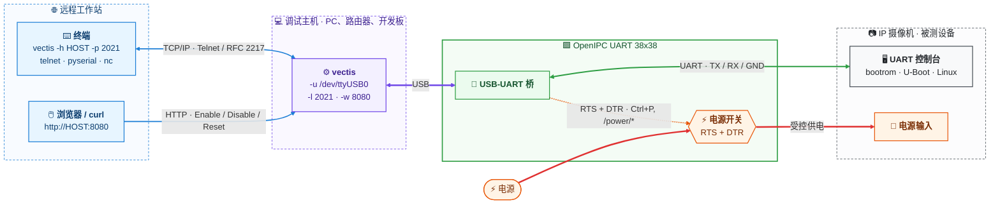
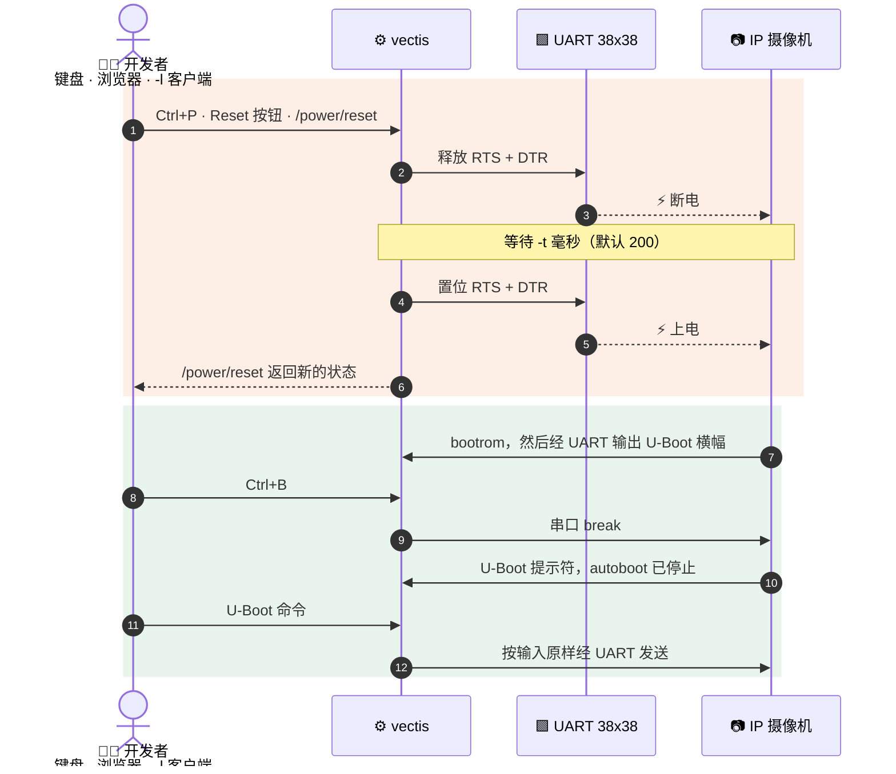
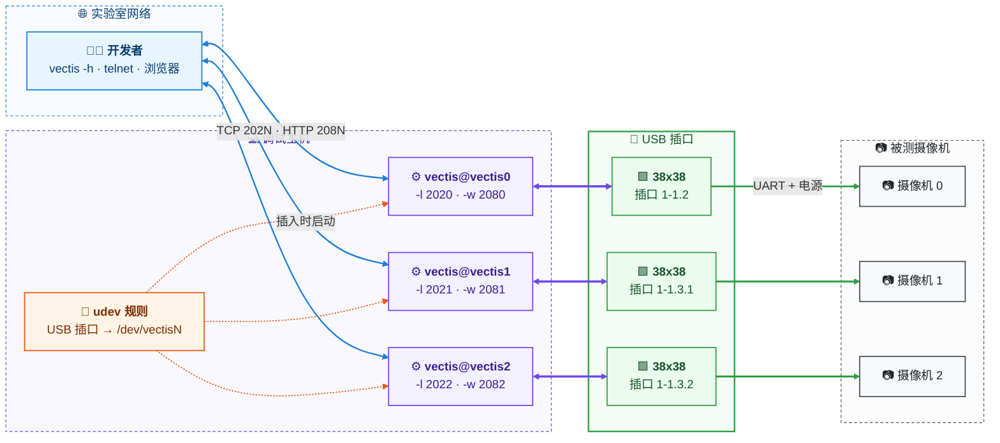
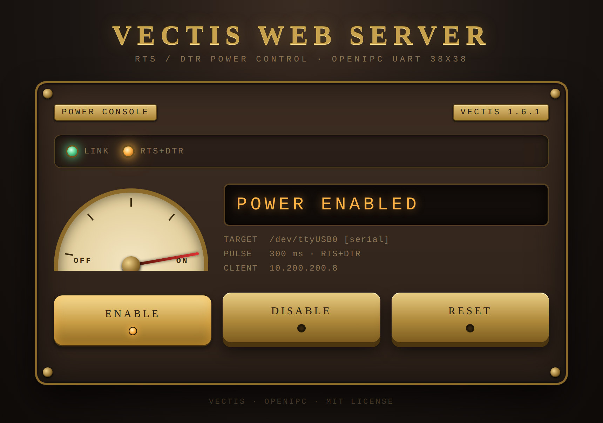

![OpenIPC logo][logo]

# OpenIPC Vectis

[English](README.md) | [Русский](README.ru.md) | **简体中文**

[](https://github.com/OpenIPC/vectis/actions/workflows/build.yml)
[](https://github.com/OpenIPC/vectis/releases/latest)
[](LICENSE)
[](https://github.com/OpenIPC/vectis)
[](#系统要求)

Vectis 是一款串口控制台，用于在配合 OpenIPC UART 38x38 板开发和集成嵌入式
系统时进行快速调试和设备控制。一个小巧的二进制文件 `vectis` 同时承担三种角色：

- **控制台** —— 将键盘桥接到串口，既可以是本地设备
  （`-u /dev/ttyUSB0`），也可以是由 RFC 2217 服务器提供的串口
  （`-h HOST -p PORT`）；按 `Ctrl+P` 在 RTS/DTR 上发出复位脉冲，
  按 `Ctrl+B` 发送 break；
- **服务器** —— `-l PORT` 通过 TCP 将本地串口提供给 telnet、
  另一个 `vectis`、pyserial 或 nc，支持 Telnet/RFC 2217 协商、
  二进制安全的数据传输，以及对波特率、线路参数和 RTS/DTR 的带外
  控制；
- **Web** —— `-w PORT` 提供一个电源控制页面（通过 RTS+DTR 实现 Enable /
  Disable / Reset），以及一个供脚本使用的小型 JSON API。

它既可以在终端中交互运行，也可以作为守护进程运行（`systemd`，无需
终端）；适配器被拔出后会自行重新打开设备链路；除 libc 外没有任何
依赖。

使用 `-U` 时，它在用户空间通过 usbfs 直接驱动 CH340/CH341 USB-UART
适配器，适用于内核中没有 `ch341` 驱动且无法重新编译内核的路由器及其他
用作调试主机的板子；参见下文“无内核驱动的 USB 模式”。

<p align="center">
  
</p>

`vectis-bootrom.c` 是本程序最初由之发展而来的 UART 桥接程序，因其
HiSilicon boot ROM 捕获扩展而保留在仓库中；其说明见
[docs/vectis-bootrom.md](docs/vectis-bootrom.md)，它不属于默认构建的一部分。

## 快速开始

在接好板子的 Linux PC 上，以 `dialout` 组中的用户运行：

```sh
# 1. 下载静态二进制文件
curl -fsSLO https://github.com/OpenIPC/vectis/releases/latest/download/vectis-linux-x86_64
install -m 755 vectis-linux-x86_64 vectis

# 2. 板子的控制台：Ctrl+P = 复位（断电重启），Ctrl+B = break，Ctrl+] = 退出
./vectis -u /dev/ttyUSB0

# 3. 共享出去：控制台在 TCP 端口 2021，电源页面在 http://<本机>:8080/
./vectis -u /dev/ttyUSB0 -l 2021 -w 8080
```

在另一台机器上，`vectis -h <host> -p 2021`（或 `telnet <host> 2021`）可打开该
控制台，`curl http://<host>:8080/power/reset` 可复位摄像机。在 OpenWrt 路由器上
请使用 `vectis-linux-mipsel`；如果路由器内核没有该适配器的驱动，请用 `-U` 加其
USB 路径代替 `-u`（参见“无内核驱动的 USB 模式”）。以服务方式运行 vectis 以及
一台主机上的多块板，见下文。

## 目录

- [快速开始](#快速开始)
- [功能特性](#功能特性)
- [系统要求](#系统要求)
- [构建](#构建)
- [发布与永久链接](#发布与永久链接)
- [硬件](#硬件)
- [整体结构](#整体结构)
- [工作原理](#工作原理)
- [用法](#用法)
- [示例](#示例)
- [会话控制](#会话控制)
- [非交互使用](#非交互使用)
- [通过 TCP 提供串口（`-l`）](#通过-tcp-提供串口-l)
- [Web 电源控制台（`-w`）](#web-电源控制台-w)
- [无内核驱动的 USB 模式（`-U`）](#无内核驱动的-usb-模式-u)
- [一台主机上的多个适配器：固定设备名（udev）](#一台主机上的多个适配器固定设备名udev)
- [将 vectis 作为服务运行（systemd）](#将-vectis-作为服务运行systemd)
- [vectis-bootrom.c：原始的 UART 桥接程序](#vectis-bootromc原始的-uart-桥接程序)
- [许可证](#许可证)
- [支持](#支持)

## 功能特性

- 支持本地串口设备（`/dev/ttyUSB*`、`/dev/ttyS*`、`/dev/ttyACM*`）或
  RFC 2217 服务器，波特率、数据位、停止位、校验位均可配置
- 连接时拉高 RTS 和 DTR，退出时释放；`Ctrl+P` 在两条线上发出
  长度可配置的复位脉冲
- `Ctrl+B` 发送串口 break（可中止 U-Boot 自动启动）
- RFC 2217 客户端：`BINARY`、`SUPPRESS-GO-AHEAD`、`COM-PORT-OPTION`、
  `0xFF` 转义、通过网络传递串口参数和 DTR/RTS、自动
  重连（`-r`）
- RFC 2217 服务器（`-l`）：同一时间一个客户端，为 nc/socat 提供原始模式，
  为 telnet/pyserial/`vectis` 提供 Telnet 模式，支持 `SET-BAUDRATE`、
  `SET-DATASIZE`、`SET-PARITY`、`SET-STOPSIZE`、`SET-CONTROL`、
  `PURGE-DATA`、`SIGNATURE`、`BRK`
- Web 电源控制台（`-w`），附带 JSON API：`/status`、`/power/enable`、
  `/power/disable`、`/power/reset`
- 适合以守护进程方式运行：不需要终端，监听端口先于设备链路启动，
  链路断开期间保持可用，每次中断只记录一行 syslog
- 通过 syslog 记录连接、电源操作和错误

## 系统要求

- Linux（glibc 或 musl）；运行时只需要 libc
- 构建需要 C99 编译器（GCC 或 Clang）和 `make`
- 对串口设备的读写权限，通常需要加入
  `dialout` 用户组
- 使用 `-U` 时：需要 usbfs（`/dev/bus/usb`）以及对其中
  适配器节点的写权限；不需要 `ch341` 或 `usbserial` 驱动

## 构建

```sh
make
```

这会构建带 `-U` 的 `vectis`（体积优化并已 strip）。`USB_CHIPS` 列出 `-U`
支持的 USB 芯片系列，它们都链接进同一个二进制文件；运行时按 USB VID:PID
选择芯片，目前只有 `ch34x`。`make USB=0` 构建不带 `-U` 的 `vectis`（仅 tty
和 RFC 2217）。`make DEBUG=1` 则构建
带调试符号、不做优化的版本。`make vectis-bootrom`
按需构建原始的桥接程序；`make all` 不会构建它。

交叉编译时指定工具链：

```sh
# ARM，32 位
make clean
make CC=arm-linux-gnueabi-gcc STRIP=arm-linux-gnueabi-strip

# AArch64
make clean
make CC=aarch64-linux-gnu-gcc STRIP=aarch64-linux-gnu-strip
```

切换工具链时请先执行 `make clean`：Make 只比较源文件和二进制文件的
时间戳，仅更换 `CC` 不会重新构建已存在的二进制文件。

每次 push 和 pull request 时，CI 都会为 x86_64、arm、aarch64 和 mipsel
构建 `vectis` 和 `vectis-bootrom`，并检查 `make USB=0` 能否构建；生成的二进制文件作为
构建产物附加在每次运行上。在 x86_64 上 CI 还会运行回归测试：测试只需要
Python 3，并用 pty 代替串口设备：

```sh
make
python3 tests/test_vectis.py .
```

## 发布与永久链接

只有一个发布版本：[`latest`](https://github.com/OpenIPC/vectis/releases/latest)。
每次 push 到 `master` 且所有构建通过后，CI 都会重新构建它；标题中带有版本号
（`Vectis X.Y.Z`），不保留按版本的发布。其中包含基于 musl 的静态二进制文件，
可在同一架构的任何 Linux 上运行：`vectis-linux-x86_64`
用于 PC 和服务器，`vectis-linux-mipsel` 用于 MIPS 小端路由器（MediaTek
MT7620/MT7621/MT7628 等，OpenWrt），软浮点，有无 FPU 均可运行。文件名不含版本号，
因此以下链接始终不变：

| 内容                  | 链接                                                                             |
|-----------------------|----------------------------------------------------------------------------------|
| 发布页面              | <https://github.com/OpenIPC/vectis/releases/latest>                              |
| `vectis-linux-x86_64` | <https://github.com/OpenIPC/vectis/releases/latest/download/vectis-linux-x86_64> |
| `vectis-linux-mipsel` | <https://github.com/OpenIPC/vectis/releases/latest/download/vectis-linux-mipsel> |

```sh
curl -fsSLO https://github.com/OpenIPC/vectis/releases/latest/download/vectis-linux-x86_64
chmod 755 vectis-linux-x86_64
```

每个新版本的二进制文件也会发布到 OpenIPC 的 Telegram 频道（[我们的频道](https://openipc.org/our-channels)），用于存档和测试下载。

发布用的二进制文件由 `ci/build-static.sh`（x86_64）和 `ci/build-mipsel.sh`
（OpenWrt 23.05.5 工具链，只下载一次并校验 SHA256；需要 curl、xz、make 和
qemu-mipsel）构建；也可以用这些脚本在本地构建：

```sh
docker run --rm -v "$PWD":/src -w /src alpine:3.22 sh ci/build-static.sh
ci/build-mipsel.sh
```

各版本的变更记录见 [CHANGELOG.md](CHANGELOG.md)。

版本号格式为 `MAJOR.MINOR.PATCH`（`vectis.c` 中的 `PROGRAM_VERSION`）：PATCH 表示修复和小改动，
MINOR 表示新功能，MAJOR 表示不兼容的变更或大规模更新，仅由维护者决定。修改代码或构建
（源代码、`Makefile`、`ci/`）的 PR 需要在合并前的最后一个提交中提升版本号，并在
`CHANGELOG.md` 中添加对应章节。仅修改文档、测试、截图或 `.github/` 中工作流的 PR 不提升
版本号。CI 会在每个 PR 中检查这一点（`.github/check-version.sh`）。

## 硬件

OpenIPC UART 38x38 板位于调试主机和被测设备之间：一个用于设备控制台的
USB-UART 桥，以及串在设备供电线路中的电源开关，由桥的 RTS 和 DTR 控制。

| 部件           | 参数                                   |
|----------------|----------------------------------------|
| 电源开关       | 最高 12 V，最大 300 mA                 |
| 开关控制       | RTS 和 DTR 同时：两者都置位 = 设备通电 |
| ALWAYS ON 跳线 | 设备始终通电，绕过开关                 |

- **电源开关。** 被测设备经由它供电：最高 12 V、300 mA。需要更大功率的设备
  不能通过该板供电。
- **ALWAYS ON 跳线。** 插上跳线后，板会持续为被测设备供电，从而不使用软件
  控制。此时 `Ctrl+P`、网页和 `/power/*` 不会切断设备电源；vectis 看不到这个
  跳线，`/status` 仍然报告 RTS+DTR 的状态。

## 整体结构



| 线条          | 连接         | 传输内容                             |
|---------------|--------------|--------------------------------------|
| 🟦 蓝色       | TCP/IP、HTTP | 网络上的控制台，来自网页的电源命令   |
| 🟪 紫色，粗线 | USB          | 主机与板之间的一切                   |
| 🟩 绿色       | UART         | 连接摄像机调试控制台的 TX、RX 和 GND |
| 🟧 橙色，虚线 | RTS + DTR    | 控制板上的电源开关                   |
| 🟥 红色，粗线 | 电源         | 摄像机的供电，由板上的开关切换       |

### 复位的步骤



无论由什么触发，电源步骤（橙色）都相同：键盘上的 `Ctrl+P`、网页、
`/power/reset`，或 `-l` 端口上的客户端发出的 RFC 2217 `SET-CONTROL`。网页也会
显示在别处发起的复位，`/status` 会给出其来源。

### RTS + DTR 随时间的变化

```text
                            vectis    Disable   Enable    Reset           vectis
                            启动                         Ctrl+P           退出
                              │         │         │         │               │
 -u                           ┌─────────┐         ┌─────────┐    ┌──────────┐
 RTS+DTR    ──────────────────┘         └─────────┘         └────┘          └───────
                                                            ◄─t─►

 -U         ────────────────────────────┐         ┌─────────┐    ┌──────────────────
 RTS+DTR                                └─────────┘         └────┘

 高 = RTS 和 DTR 置位 = 摄像机通电（逻辑状态，而非引脚电压）
 t  = 复位脉冲长度，-t MS（默认 200 ms）
```

- 使用 `-u` 时，打开 tty 会置位两条线，关闭时将其释放，因此启动或重启
  vectis 会使摄像机断电重启。
- 使用 `-U` 时，vectis 启动时设置线路而不先释放，退出时保持原样，因此重启
  或更新 vectis 不会影响摄像机。需要复位时请使用 `Ctrl+P` 或 `/power/reset`。

### 多台摄像机的测试台



每块板按其所插入的 USB 插口命名，而不是按内核发现它的顺序，并拥有自己的
服务实例及各自的 TCP 和 Web 端口（`/etc/vectis/vectisN.conf`）。把板插入已知
插口会启动其实例，拔出则停止该实例。参见下文“一台主机上的多个适配器”。

## 工作原理

在 RFC 2217 客户端模式下，`vectis` 连接到 TCP 服务器，将本地终端切换为原始模式，
并与服务器协商以下 Telnet 选项：`BINARY`、`SGA`
和 `COM-PORT-OPTION`（RFC 2217）。在短暂等待服务器的协商应答之后，
它通过发送 `SET_BAUDRATE`、`SET_DATASIZE`、
`SET_STOPSIZE`、`SET_PARITY` 和 `SET_CONTROL` 子选项来配置远端串口（先关闭流控，
再拉高 DTR 和 RTS）。服务器的应答会被记录到日志中，因此如果服务器
无法应用某个波特率，`server confirmed baud` 这一行中就会显示不同的数值。
TCP 套接字使用 10 秒的连接超时、`TCP_NODELAY`（使按键立即发出），
以及 keep-alive 探测，可在大约 20 秒内发现被静默断开的链路。

接收到的字节流按 Telnet/RFC 2217 解析：普通数据字节
写入 stdout，`IAC` 序列（`0xFF`）被截获并单独处理，
转义的 `0xFF 0xFF` 对在转发到终端之前被还原为单个 `0xFF`。
发出的键盘输入以二进制模式发送，其中的 `0xFF` 字节按 RFC 854
转义为 `IAC IAC`。

**Ctrl+P** 向目标设备发送复位脉冲：发出 `SET_CONTROL`
命令，将 DTR 和 RTS 拉低一段可配置的时间（默认 200 ms），然后
重新拉高。在直连串口模式下，同样的脉冲通过 `ioctl(TIOCMBIC/TIOCMBIS)`
作用于本地串口。**Ctrl+B** 发送 break：在 RFC 2217 模式下为 `IAC BRK`，
在直连串口模式下为 `tcsendbreak()`。

在直连串口模式下，打开设备时拉高 DTR 和 RTS，退出时
再次释放，并恢复原有的 termios 设置。

## 用法

```sh
./vectis -h <host> -p <port> [options]
./vectis -u <device> [options]
```

每个选项都有对应的长格式。注意 `-h` 是 *host* 选项；
帮助是 `--help` 或 `-?`。

RFC 2217/Telnet 模式：

- `-h HOST`、`--host HOST` —— RFC 2217 服务器地址（主机名或 IP，IPv4/IPv6）
- `-p PORT`、`--port PORT` —— TCP 端口（`1..65535`）

直连串口模式：

- `-u DEVICE`、`--device DEVICE` —— 本地 tty 设备路径，例如 `/dev/ttyUSB0`

USB 模式（`make USB=0` 构建中没有）：

- `-U SPEC`、`--usb SPEC` —— 通过 usbfs 驱动的 USB-UART；`SPEC` 是适配器的
  USB 路径（`1-1.3.4`，与 `/sys/bus/usb/devices` 中一致）、`usb:VID:PID`
  （找到的第一个此类设备）或 `usb:VID:PID@PATH`；参见下文“无内核驱动的
  USB 模式”

这些模式互斥。

串口参数（默认 **115200 8N1**）：

- `-b BAUD`、`--baud BAUD` —— 波特率（默认 `115200`，最大 `921600`）。
  直连串口模式接受标准波特率 `300`、`1200`、`2400`、
  `4800`、`9600`、`19200`、`38400`、`57600`、`115200`、`230400`、`460800`
  和 `921600`；RFC 2217 模式将该值原样传给服务器。
- `-d 5|6|7|8`、`--data-bits N` —— 数据位（默认 8）
- `-s 1|2`、`--stop-bits N` —— 停止位（默认 1）
- `-y N|E|O`、`--parity X` —— 校验位：None/Even/Odd（默认 N）

连接选项：

- `-r`、`--reconnect` —— 断开后自动重连，每 5 秒
  重试一次（仅限 RFC 2217 模式；使用 `-l` 或 `-w` 时，两种模式下
  都会自动重新打开链路，无需此选项）
- `-t MS`、`--reset-ms MS` —— 复位脉冲时长，单位毫秒，
  `1..60000`（默认 200）
- `-n`、`--no-crlf` —— 禁用 LF→CR+LF 转换（适用于本身已发送 `\r\n` 的设备，或用于二进制采集）
- `-l [ADDR:]PORT`、`--listen [ADDR:]PORT` —— 将本地串口（`-u`、`-U`）
  同一时间提供给一个 TCP 客户端：telnet、另一个 `vectis -h HOST -p PORT`、
  pyserial `rfc2217://`，或原始模式的 nc/socat；参见下文
  “通过 TCP 提供串口”
- `-w [ADDR:]PORT`、`--web [ADDR:]PORT` —— 在该端口上启动内置的 Web 电源
  控制台（除非指定了 IPv4 地址，否则监听所有接口）；
  参见下文“Web 电源控制台”
- `-v`、`--version` —— 打印版本号和发布日期
- `--help`、`-?` —— 帮助

## 示例

```sh
# 115200 8N1 —— 所有参数均为默认值
./vectis -h 192.168.1.10 -p 7000

# 9600 8E1
./vectis -h 192.168.1.10 -p 7000 -b 9600 -y E

# 断开后自动重连
./vectis -h 192.168.1.10 -p 7000 -r

# 直连串口设备，115200
./vectis -u /dev/ttyUSB0

# 直连串口设备，波特率 460800，复位脉冲 500 ms
./vectis -u /dev/ttyUSB0 -b 460800 -t 500

# 将设备输出采集到文件（非交互，不做 CRLF 转换）
./vectis -h 192.168.1.10 -p 7000 -n > boot.log

# 串口控制台，外加位于 http://<本机>:8080/ 的 Web 电源控制台
./vectis -u /dev/ttyUSB0 -w 8080

# 一个进程包揽一切：本地控制台、在 TCP 2021 上提供 UART、Web 位于 2081
./vectis -u /dev/ttyUSB0 -l 2021 -w 2081
```

## 会话控制

这些快捷键仅在交互模式下（stdin 为终端时）生效。
在非交互模式下（stdin 来自管道或重定向），所有字节
都原样转发给设备，因此数据流中的控制字符
永远不会被误当作命令。

| 按键     | 操作                                                            |
|----------|-----------------------------------------------------------------|
| `Ctrl+P` | RTS+DTR 脉冲 —— 复位目标设备                                    |
| `Ctrl+B` | 发送 break 信号 —— 中止 U-Boot 自动启动，触发引导加载程序提示符 |
| `Ctrl+]` | 退出                                                            |

`Ctrl+C` 与其他字节一样被传给设备；请使用 `Ctrl+]`
退出。从其他地方发送 `SIGINT` 或 `SIGTERM` 同样会干净地结束
会话。如果控制终端消失，`vectis` 会自行
退出。

当设备链路断开、`vectis` 正在等待重连时（`-r`、`-l`、`-w`），
`Ctrl+]` 同样有效。在此期间输入的其他按键会被
丢弃，而不会在链路恢复时一次性全部发送给
设备。

复位脉冲不会阻塞程序：在 RTS 和 DTR 处于低电平期间，
设备输出照常流动，键盘、`-l` 客户端和
Web 页面也保持响应。脉冲期间再次按下 `Ctrl+P` 会被忽略。

## 非交互使用

当 stdin 不是终端时，`vectis` 跳过原始终端设置，
将所有输入直接转发给设备。stdin 到达 EOF 后，
输入端就结束了，但设备的应答可能仍在传输途中，
因此 `vectis` 停止读取 stdin，继续将设备输出转发到
stdout，直到连接关闭或收到信号为止。可以用 `timeout`
限定脚本会话的时长：

```sh
# 发送一条 U-Boot 命令，并采集 3 秒内的响应
echo "printenv" | timeout 3 ./vectis -h 192.168.1.10 -p 7000 -n > env.txt

# 从文件输入一系列命令，采集 10 秒内的输出
timeout 10 ./vectis -u /dev/ttyUSB0 < commands.txt > output.txt
```

状态信息输出到 stderr 和 syslog，因此 stdout 中只有
设备的数据。

## 通过 TCP 提供串口（`-l`）

`-l PORT`（或 `-l ADDR:PORT`）把直连串口会话变成针对同一串口的
小型 RFC 2217 服务器，这样一个 `vectis` 进程就可以同时充当
本地控制台、网络接入点，以及（配合 `-w`）Web 电源
控制台：

```sh
./vectis -u /dev/ttyUSB0 -l 2021 -w 2081
```

可以与之配合使用的客户端：

```sh
vectis -h 192.168.1.20 -p 2021          # 另一个 vectis，支持 Ctrl+P / Ctrl+B
telnet 192.168.1.20 2021                    # 二进制数据通道，在转义提示符下输入 "send brk"
python3 -c "import serial; s = serial.serial_for_url('rfc2217://192.168.1.20:2021'); s.dtr = False"
socat -,raw,echo=0 TCP:192.168.1.20:2021    # 原始模式，Ctrl+P 复位目标设备
nc 192.168.1.20 2021                        # 原始模式，逐行发送
```

其行为与原始的 `vectis-bootrom` 服务器一致：

- 同一时间一个客户端；新连接会替换当前连接。
- 连接以**传统原始模式**开始：字节直接透传，`LF`
  和 `CR LF` 被转换为 `CR`，使回车能送达 U-Boot，`Ctrl+P`（`0x10`）
  触发复位脉冲。不添加回显。
- 客户端发来的第一个 Telnet `IAC` 字节会将连接永久切换到
  **Telnet/RFC 2217 模式**：协商 `BINARY`、`SUPPRESS-GO-AHEAD` 和
  `COM-PORT-OPTION`，`0xFF` 在两个方向上都被转义，
  并且不再截获 `Ctrl+P`（数据通道是二进制安全的）。
- 在 Telnet 模式下，客户端可以修改本地串口参数：`SET-BAUDRATE`
  （最高 921600 的标准波特率）、`SET-DATASIZE`（5..8）、`SET-PARITY`
  （none/odd/even）、`SET-STOPSIZE`（1 或 2）、`PURGE-DATA`，并可通过
  `SET-CONTROL` 控制 DTR 和 RTS；每个应答都报告实际
  生效的值。空的 `SIGNATURE` 请求以
  `vectis <version>` 应答；客户端自身的签名只记录到日志，不做
  应答。Telnet `BRK` 会发送串口 break。`vectis-bootrom` 的 HiSilicon `BOOTROM-CATCH` 扩展
  在此未实现。
- 客户端的所有操作都会连同其地址一起记录到日志，Web
  页面和 `/status` 会显示已连接的客户端。
- 与 `vectis-bootrom` 一样，客户端发来 EOF 即结束会话。
  `nc` 在 stdin 耗尽时正是这样做的（`echo cmd | nc host 2021`），
  因此对于脚本化的一次性命令，建议使用 `vectis -h host -p 2021`
  或 `socat`，它们会保持连接打开。

本地终端、Web 控制台和 TCP 客户端并行操作同一个
串口：设备输出发送给所有一方，任何一方的输入
都发送给设备，一方执行的电源操作对其他方
可见。如果设备链路断开，监听端口仍保持运行，客户端可以
连接并完成协商，在链路恢复之前它们的数据会被丢弃，
之后串口将按命令行参数重新打开。与 `-w` 一样，`-l`
会让进程自动重新打开链路；它需要配合 `-u` 使用。

## Web 电源控制台（`-w`）

<p align="center">
  
</p>

<p align="center"><sub>vectis 1.6.1 运行在 OpenIPC Dev Board 上，以 <code>-w 8080 -l 2021 -t 300</code> 提供其 <code>/dev/ttyUSB0</code>；另一个 <code>vectis</code> 已连接到 <code>-l</code> 端口。</sub></p>

`-w PORT`（或 `-w ADDR:PORT`，仅在一个 IPv4 地址上监听）会在终端会话
之外启动一个内置 Web 服务器。它只提供一个页面，
外观是一块黄铜铆钉风格的控制面板，标题为
**Vectis Web Server**，上面有三个锁存按钮：

| 按钮      | 操作                                                | 指示灯                         |
|-----------|-----------------------------------------------------|--------------------------------|
| `Enable`  | 拉高 RTS+DTR（设备上电）                            | 通电期间点亮                   |
| `Disable` | 释放 RTS+DTR（设备断电）                            | 断电期间点亮                   |
| `Reset`   | 持续 `-t` 毫秒的 RTS+DTR 脉冲，与 `Ctrl+P` 完全相同 | 脉冲期间点亮，并显示旋转的齿轮 |

按下按钮时会播放动画，指示灯（链路、RTS+DTR）和仪表
指针跟随设备状态变化，页面每两秒轮询一次该状态，
因此来自键盘的 `Ctrl+P` 或在另一个浏览器中的按键
也会显示出来。这些按钮使用与终端会话完全相同的传输方式：
`-u` 模式下对本地串口执行 `ioctl`，`-h`/`-p` 模式下通过 RFC 2217
发送 `SET-CONTROL`。终端会话、快捷键以及所有
其他行为都保持不变，并与该页面并行
工作。

使用 `-w` 时，Web 服务器在设备链路打开之前就已开始监听，
并且无论在哪种模式下，只要链路失败或断开，都会自动（重新）建立，
因此页面可以立即访问，并在摄像机被拔出或服务器重启期间
保持可用。在此期间，页面显示
`Link offline`，按钮拒绝执行操作。一次中断只记录
第一次失败。

页面所做的一切都可以通过普通 URL 完成，因此 `curl`、shell
脚本或浏览器书签都能以同样的方式控制设备：

| URL              | 方法        | 操作                         | 应答           |
|------------------|-------------|------------------------------|----------------|
| `/`              | GET         | 页面本身                     | HTML           |
| `/status`        | GET         | 当前状态                     | JSON           |
| `/power/enable`  | GET 或 POST | 拉高 RTS+DTR                 | JSON，完整状态 |
| `/power/disable` | GET 或 POST | 释放 RTS+DTR                 | JSON，完整状态 |
| `/power/reset`   | GET 或 POST | RTS+DTR 脉冲；脉冲结束后应答 | JSON，完整状态 |

复位脉冲在后台运行：在脉冲持续期间，`/status`、
其他页面、终端和 `-l` 客户端照常得到服务，
第二个 `/power/reset` 会加入正在进行的脉冲。最多六个
`/power/reset` 请求会等待脉冲结束；更多的请求会立即
以当前状态应答，因此页面和 `/status`
总能找到空闲的连接槽位。在发送请求后关闭自身
发送端的客户端（`nc -N`）仍然能收到应答。在脉冲期间
收到 `/power/enable`、`/power/disable` 或 RFC 2217 `SET-CONTROL`
会结束脉冲：线路保持该命令设定的状态，
正在等待的 `/power/reset` 会立即以该状态应答。如果
链路在脉冲期间断开，`/power/reset` 应答 `503`。

```sh
curl -s http://192.168.1.20:8080/status
curl -s http://192.168.1.20:8080/power/reset
```

```json
{"link":"online","mode":"serial","target":"/dev/ttyUSB0","power":"on",
 "rts":1,"dtr":1,"reset_ms":200,"tcp_client":"192.168.1.5",
 "event":{"seq":7,"kind":"reset","source":"rfc2217","ago_ms":1830},
 "version":"1.7.0"}
```

`link` 为 `online` 或 `offline`；`power` 是本进程最后一次
下达的状态；`rts`/`dtr` 在 `-u` 模式下是真实的 modem 位，在 `-U` 模式下是
最后一次设置的状态（不可用时或在 RFC 2217 模式下为 `-1`）；`tcp_client` 是 `-l` 客户端的地址
或 `null`；`event` 是来自任意一方的最近一次电源线路
变化：`kind` 为 `on`、`off` 或 `reset`（同一来源在 5 秒内
先 off 后 on），`source` 为 `web`、
`keyboard`、`tcp`（原始客户端，`Ctrl+P`）、`rfc2217`（来自
Telnet 客户端的 `SET-CONTROL`）或 `link`（打开串口时拉高），`seq`
随每个事件递增，`ago_ms` 表示事件发生在多久之前。
页面借此显示在别处触发的复位：来自键盘或来自
`vectis -h HOST -p PORT` 客户端的 `Ctrl+P` 会使
Reset 按钮点亮、指针摆动，日志行中会注明
来源。裸 `telnet` 会把 `Ctrl+P` 当作数据发送，因此这种情况下
设备和页面上都不会有任何反应。命令 URL 对
所有客户端（包括浏览器）都以 JSON 应答，因此从
书签打开的 `/power/reset` 会以文本形式显示操作后的状态。页面只在
请求裸 `/` 时提供；在其后附加任何内容都会应答 `404`。链路
断开期间，`/power/` 命令应答 `503`；未知命令应答
`404`。命令 URL 上的查询字符串会被忽略。

没有任何身份验证。请将控制台绑定到受信任的接口
（`-w 127.0.0.1:8080`），或将端口限制在实验室网络内，与
`-l` 监听端口的做法相同。

```sh
# 串口适配器，Web 控制台监听所有接口，端口 8080
./vectis -u /dev/ttyUSB0 -w 8080

# 无界面运行：不需要终端，设备输出写入日志，控制台仅监听 localhost
./vectis -h 192.168.1.10 -p 35240 -w 127.0.0.1:8080 -n < /dev/null > uart.log 2>&1 &
```

## 无内核驱动的 USB 模式（`-U`）

`vectis -U` 通过内核的 usbfs 接口自行驱动 CH340/CH341 适配器，
无需 `ch341` 或 `usbserial` 驱动。只有在内核缺少该驱动且无法重新编译的
主机上才使用此模式：路由器以及其他用作调试主机的板子。在其他所有系统上，
包括桌面 Linux、macOS 和 Windows，请使用标准驱动和 `-u /dev/ttyUSB0`。

```sh
./vectis -U 1-1.3.4 -l 2021 -w 2081      # 按 USB 路径
./vectis -U usb:1a86:7523                # 找到的第一个 CH340
```

一切都与 `-u` 相同：控制台、`-l`、`-w`、`Ctrl+P`、`Ctrl+B`，通过 RFC 2217
控制波特率、线路参数和 RTS/DTR，以及适配器丢失后重新打开链路。区别如下：

- **RTS/DTR 在重启后保持不变。** 使用 `-u` 时，内核在关闭 tty 时会撤销
  这两条线路，因此重启 vectis 会让目标设备断电重启。使用 `-U` 时，vectis
  退出时保持线路原样，启动时直接设置线路而不先撤销，因此更新或重启 vectis
  不会让设备复位。需要复位时请使用 `/power/reset` 或 `Ctrl+P`。
- **从内核驱动接管适配器会复位一次。** 如果 `ch341` 已绑定到该适配器，
  vectis 会将其分离，内核此时会撤销线路。在适配器重新插拔或主机重启之前，
  驱动保持分离状态；在此期间该适配器的 `/dev/ttyUSB*` 不存在。
- **其他程序没有 tty 可用。** vectis 占用适配器时，minicom、picocom 或
  pyserial 无法打开它：请改为连接 `-l` 端口（pyserial 中使用
  `rfc2217://HOST:PORT`）。
- `/status` 中的 `rts`/`dtr` 显示最后一次设置的状态：芯片无法报告其输出。
- 仅支持 CH340/CH341（`1a86:7523`、`1a86:7522`、`1a86:5523` 以及 Linux
  `ch341` 驱动认识的其他 ID）；仅支持 Linux。已在芯片版本 0x31 上验证；
  版本低于 0x30 的芯片只支持 8N1，并且每次启动都会初始化，因此重启时
  线路可能被撤销（vectis 会记录警告）。

主机需要支持 USB 主机和 usbfs 的内核（`/dev/bus/usb`，由 devtmpfs 创建）；
不需要 `ch341` 和 `usbserial`。运行 vectis 的用户需要对适配器节点
`/dev/bus/usb/BBB/DDD` 有读写权限。root 拥有该权限；其他用户需要添加 udev
规则。每次重新插拔后节点编号都会变化，因此规则按 USB 路径匹配：

```sh
sudo tee /etc/udev/rules.d/71-vectis-usb.rules >/dev/null <<'EOF'
# vectis -U: raw USB access to the CH340 at USB path 1-1.3.4 for the dialout group
SUBSYSTEM=="usb", ENV{DEVTYPE}=="usb_device", ATTR{idVendor}=="1a86", KERNEL=="1-1.3.4", GROUP="dialout", MODE="0660"
EOF
sudo udevadm control --reload
sudo udevadm trigger --action=change /sys/bus/usb/devices/1-1.3.4
```

并将该用户加入 `dialout`（`sudo usermod -aG dialout USER`，下次登录后生效）。
分离内核驱动只需要对该节点有写权限。在 OpenWrt 等没有 udev 的系统上，
守护进程通常以 root 运行，无需其他设置。

## 一台主机上的多个适配器：固定设备名（udev）

`/dev/ttyUSB0`、`/dev/ttyUSB1`……按内核发现适配器的
顺序编号，这个顺序会随插入顺序、其他 USB
设备的插拔以及每次启动而变化。以
`-u /dev/ttyUSB0` 启动的守护进程可能在不知不觉中连到另一块板子上。应当把
设备名绑定到不会变化的东西上。

带有出厂序列号的适配器（FTDI、CP210x、CH343/CH9102）会自动在
`/dev/serial/by-id/` 中获得固定的名称；在 `-u` 中使用该路径即可，
无需其他操作。CH340 适配器（`1a86:7522`、`1a86:7523`
及其仿制品）没有序列号，因此多个此类适配器会合并为同一个
`by-id` 条目。对于这类适配器，请用 udev 规则将名称绑定到
**物理 USB 插口**。下面是一个包含五个 CH340 适配器的完整示例，其中一个
插在 PC 的插口上，四个插在 USB 集线器上：

1. 查看 udev 已经知道的拓扑结构。`:1.0` 之前最后一个点
   后面的数字，就是链路中最后一个集线器上的端口号：

   ```sh
   ls -l /dev/serial/by-path/
   # pci-0000:00:1d.0-usb-0:1.2:1.0-port0   -> ../../ttyUSB1   (内置集线器的 2 号端口)
   # pci-0000:00:1d.0-usb-0:1.3.2:1.0-port0 -> ../../ttyUSB2   (插在 3 号端口上的外置集线器的 2 号端口)
   # pci-0000:00:1d.0-usb-0:1.3.3:1.0-port0 -> ../../ttyUSB0   (该集线器的 3 号端口)
   ```

   （`usbv2-...` 条目是按较新命名方案生成的相同链接。）

2. 获取相同端口的内核名称，即 `KERNELS==` 的取值：

   ```sh
   for d in /dev/ttyUSB*; do echo -n "$d  "; udevadm info -q property -n $d | grep -oP 'DEVPATH=.*/\K[0-9.-]+(?=:1\.0/)'; done
   # /dev/ttyUSB0  1-1.3.3
   # /dev/ttyUSB1  1-1.2
   # /dev/ttyUSB2  1-1.3.2
   ```

   要弄清哪个插口对应哪个名称，可以拔下一个适配器，再次运行
   该命令，看哪一行消失了；然后给该插口贴上标签。

3. 编写规则，每个插口一行，写入 `/etc/udev/rules.d/99-vectis-boards.rules`：

   ```
   SUBSYSTEM=="tty", ATTRS{idVendor}=="1a86", ATTRS{idProduct}=="7522", KERNELS=="1-1.2",   SYMLINK+="vectis0", GROUP="dialout", MODE="0660", TAG+="systemd", ENV{SYSTEMD_WANTS}+="vectis@vectis0.service"
   SUBSYSTEM=="tty", ATTRS{idVendor}=="1a86", ATTRS{idProduct}=="7522", KERNELS=="1-1.3.1", SYMLINK+="vectis1", GROUP="dialout", MODE="0660", TAG+="systemd", ENV{SYSTEMD_WANTS}+="vectis@vectis1.service"
   SUBSYSTEM=="tty", ATTRS{idVendor}=="1a86", ATTRS{idProduct}=="7522", KERNELS=="1-1.3.2", SYMLINK+="vectis2", GROUP="dialout", MODE="0660", TAG+="systemd", ENV{SYSTEMD_WANTS}+="vectis@vectis2.service"
   SUBSYSTEM=="tty", ATTRS{idVendor}=="1a86", ATTRS{idProduct}=="7522", KERNELS=="1-1.3.3", SYMLINK+="vectis3", GROUP="dialout", MODE="0660", TAG+="systemd", ENV{SYSTEMD_WANTS}+="vectis@vectis3.service"
   SUBSYSTEM=="tty", ATTRS{idVendor}=="1a86", ATTRS{idProduct}=="7522", KERNELS=="1-1.3.4", SYMLINK+="vectis4", GROUP="dialout", MODE="0660", TAG+="systemd", ENV{SYSTEMD_WANTS}+="vectis@vectis4.service"
   ```

   每一行做两件事：为端口命名（`SYMLINK+=`），并
   告诉 systemd 在该端口出现时启动对应的服务实例
   （`TAG+="systemd"`、`SYSTEMD_WANTS`）。`ATTRS{idVendor}`
   和 `ATTRS{idProduct}` 来自 `lsusb`；保留它们，这样规则就不会
   把恰好插在该插口上的键盘重命名。目前空着的插口
   （上例中的 `1-1.3.1`、`1-1.3.4`）可以预先
   列出：在有适配器插入之前不会发生任何事情。

4. 应用规则并检查：

   ```sh
   udevadm control --reload && udevadm trigger --subsystem-match=tty --action=change && udevadm settle
   ls -l /dev/vectis*
   # /dev/vectis0 -> ttyUSB1
   # /dev/vectis2 -> ttyUSB2
   # /dev/vectis3 -> ttyUSB0
   ```

5. 在所有地方使用这些名称：交互使用时为 `vectis -u /dev/vectis3`，
   守护进程则使用下面的模板服务，每个适配器一个实例，
   由设备本身启动和停止。

说明：

- 集线器级联时，请使用完整路径。像
  `KERNELS=="*.2"` 这样的通配符会同时匹配 `1-1.2` 和 `1-1.3.2`。
- 路径中包含集线器本身所插的插口：把
  集线器从 `1-1.3` 移到其他插口，会改变其上所有适配器的 `1-1.3.x`，
  规则也必须随之修改。直接插在
  PC 上的适配器只取决于它自己的插口。
- 混用不同型号的适配器也是一种办法：即使没有序列号，`by-id`
  也能根据厂商 ID 和产品 ID 区分 CH340、CP2102 和 FTDI。
  只有完全相同且没有序列号的适配器才需要上面的规则。

### 每个适配器一个服务实例，由设备启动

有了上面的规则，守护进程完全不需要 `systemctl enable`。
模板单元 `vectis@.service` 描述一个实例；当 `/dev/vectisN` 出现时
（开机时或热插拔时），udev 启动 `vectis@vectisN`，
适配器被拔出时由 `BindsTo=` 将其停止。已知插口上
插了多少个适配器，就运行多少个实例。

```ini
# /etc/systemd/system/vectis@.service  —— 实例 %i = vectis0, vectis1, ...
[Unit]
Description=Vectis console on /dev/%i
BindsTo=dev-%i.device
After=dev-%i.device network.target

[Service]
Type=simple
EnvironmentFile=/etc/vectis/%i.conf
ExecStart=/usr/local/bin/vectis -u /dev/%i -b ${BAUD} -t ${RESET_MS} -l ${TCP_PORT} -w ${WEB_PORT} -n
StandardInput=null
StandardOutput=journal
StandardError=journal
Restart=on-failure
RestartSec=5
User=vectis
SupplementaryGroups=dialout
NoNewPrivileges=yes
ProtectSystem=strict
ProtectHome=yes
PrivateTmp=yes
```

这里有意没有 `[Install]` 段：设备是启动实例的唯一
途径。每个适配器都需要自己的配置
文件，因为各实例的 TCP 端口和 Web 端口必须互不相同；
缺少配置文件的实例会启动失败，并在 journal 中给出
提示。

```sh
# /etc/vectis/vectis3.conf —— 每个适配器一个文件，文件名 = udev 链接名
BAUD=115200
RESET_MS=300
TCP_PORT=2023
WEB_PORT=2083
```

把所有文件放到位，然后让 udev 重新评估
已经插入的端口：

```sh
sudo install -m 755 vectis /usr/local/bin/
sudo useradd --system --no-create-home --shell /usr/sbin/nologin vectis
sudo mkdir -p /etc/vectis          # 每个适配器一个 vectisN.conf
sudo systemctl daemon-reload
sudo udevadm control --reload && sudo udevadm trigger --subsystem-match=tty --action=change && udevadm settle
systemctl list-units 'vectis@*'    # 每个已插入的适配器对应一个活动实例
journalctl -u vectis@vectis3 -f
curl -s http://127.0.0.1:2083/status
```

此后，把适配器插入已知插口就会启动它的
实例，拔出则停止该实例，重启后启动的
恰好是当前存在的那些适配器。

## 将 vectis 作为服务运行（systemd）

`vectis` 不需要终端：stdin 关闭时，它继续转发
设备输出（这里是转发到 journal），监听端口保持运行，
适配器消失后设备链路会自动重新打开。对于
多个适配器，请使用上一节中由设备启动的模板。对于单个适配器，普通的
单元就足够了；下面这个单元在 TCP 端口 2021 上提供由上述 udev 规则命名为
`/dev/vectis1` 的适配器，Web 控制台位于端口 2081，复位脉冲为 300 ms：

```ini
# /etc/systemd/system/vectis.service
[Unit]
Description=Vectis serial console: UART on TCP 2021, web power control on 2081
After=network.target

[Service]
Type=simple
ExecStart=/usr/local/bin/vectis -u /dev/vectis1 -b 115200 -t 300 -l 2021 -w 2081
# 设备输出写入 journal；状态信息输出到 stderr 和 syslog
StandardInput=null
StandardOutput=journal
StandardError=journal
Restart=on-failure
RestartSec=5
# 以属于串口所属用户组（dialout，由 udev 规则设定）的非特权用户运行
User=vectis
SupplementaryGroups=dialout
# 安全加固
NoNewPrivileges=yes
ProtectSystem=strict
ProtectHome=yes
PrivateTmp=yes

[Install]
WantedBy=multi-user.target
```

```sh
sudo install -m 755 vectis /usr/local/bin/
sudo useradd --system --no-create-home --shell /usr/sbin/nologin vectis
sudo systemctl daemon-reload
sudo systemctl enable --now vectis
systemctl status vectis
journalctl -u vectis -f          # 设备输出和状态信息
curl -s http://127.0.0.1:2081/status
vectis -h 127.0.0.1 -p 2021      # 通过该服务使用交互式控制台
```

`systemctl stop` 发送 `SIGTERM`，`vectis` 对其的处理是
在退出前释放 RTS/DTR 并恢复串口设置。如果 journal 中出现多余的 `CR` 字符，
请在 `ExecStart` 中加上 `-n`：LF→CR+LF
转换是为原始终端准备的，而不是为日志文件准备的。该单元
有意没有绑定到设备：即使适配器不在，守护进程也会在开机时启动，
Web 页面显示 `Link offline`，一旦适配器出现，链路
就会被打开。`/dev/vectis1` 来自上一节中的
udev 规则；如果没有这样的规则，请使用
`/dev/serial/by-id/...` 路径，单个适配器时也可以使用 `/dev/ttyUSB0`。对于 RFC 2217
客户端模式，请将 `-u /dev/ttyUSB0` 替换为 `-h HOST -p PORT`，并去掉 `-l`
和 `.device` 相关的行。

## vectis-bootrom.c：原始的 UART 桥接程序

`vectis-bootrom.c` 是本仓库最初的程序：一个面向 OpenIPC UART 38x38 板的
UART 终端和 TCP 桥接程序，具有相同的
RTS/DTR 复位脉冲，后来又扩展了 TCP 监听端口上的 RFC 2217 自动检测、
inetd/inittab 集成，以及一个厂商扩展
`BOOTROM-CATCH`——它在 UART 旁边就地执行 HiSilicon boot ROM 的 `0x20` 标记 /
`0xAA` 应答握手，从而能在往返时延很高的链路上
工作。它的其他所有功能现在都已由 `vectis` 覆盖
（`-u` 用于控制台，`-l` 用于 TCP 端，`-w` 用于电源控制），
因此保留该文件仅作参考，以及为了那个 boot ROM 扩展。它
默认不参与构建：

```sh
make vectis-bootrom        # 或：cc -std=gnu99 -Os -o vectis-bootrom vectis-bootrom.c
```

其选项、热键、带 `BOOTROM-CATCH` 扩展的 RFC 2217 模式以及 inetd/inittab 集成，
见 [docs/vectis-bootrom.md](docs/vectis-bootrom.md)（英文）。

## 许可证

[MIT](LICENSE)。完整条款请参见 [LICENSE](LICENSE)。

## 支持

- 问题咨询与缺陷报告：[GitHub Issues](https://github.com/OpenIPC/vectis/issues)
- 文档：[openipc.org](https://openipc.org)

[](https://openipc.org/our-channels)

[logo]: https://raw.githubusercontent.com/OpenIPC/.github/refs/heads/main/assets/openipc-logo-black.svg
