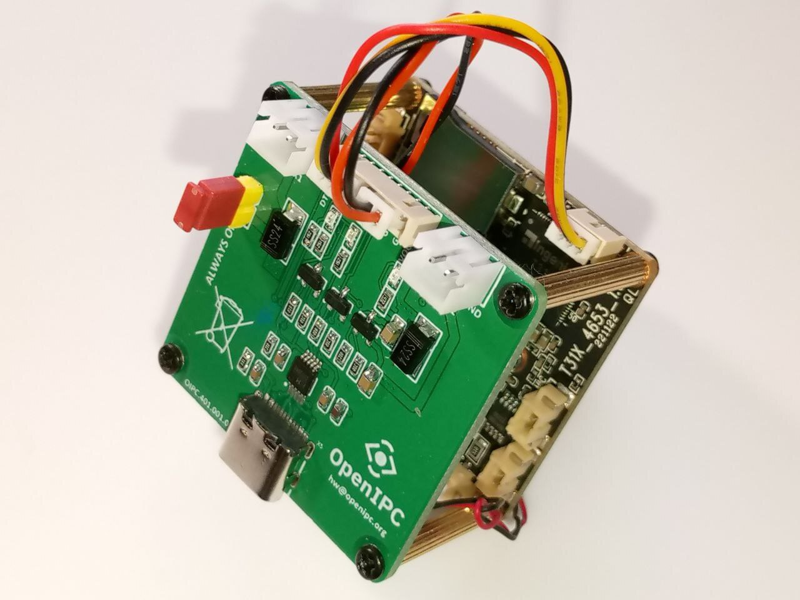

![OpenIPC logo][logo]

# OpenIPC Vectis

[English](README.md) | [Русский](README.ru.md) | **简体中文**

[](https://github.com/OpenIPC/vectis/actions/workflows/build.yml)
[](LICENSE)
[](https://github.com/OpenIPC/vectis)
[](#系统要求)

Vectis 是一款串口控制台，用于在配合 OpenIPC UART 38x38 板开发和集成嵌入式
系统时进行快速调试和设备控制。一个小巧的二进制文件 `vectis` 同时承担三种角色：

- **控制台** —— 将键盘桥接到串口，既可以是本地设备
  （`-u /dev/ttyUSB0`），也可以是由 RFC 2217 服务器提供的串口
  （`-h HOST -p PORT`）；按 `Ctrl+P` 在 RTS/DTR 上发出复位脉冲，
  按 `Ctrl+B` 发送 break；
- **服务器** —— `-l PORT` 通过 TCP 将本地串口提供给 telnet、
  另一个 `vectis`、pyserial 或 nc，支持 Telnet/RFC 2217 协商、
  二进制安全的数据传输，以及对波特率、线路参数和 RTS/DTR 的带外
  控制；
- **Web** —— `-w PORT` 提供一个电源控制页面（通过 RTS+DTR 实现 Enable /
  Disable / Reset），以及一个供脚本使用的小型 JSON API。

它既可以在终端中交互运行，也可以作为守护进程运行（`systemd`，无需
终端）；适配器被拔出后会自行重新打开设备链路；除 libc 外没有任何
依赖。

<p align="center">
  
</p>

`vectis-bootrom.c` 是本程序最初由之发展而来的 UART 桥接程序，因其
HiSilicon boot ROM 捕获扩展而保留在仓库中；本文档末尾对其进行了说明，
它不属于默认构建的一部分。

## 功能特性

- 支持本地串口设备（`/dev/ttyUSB*`、`/dev/ttyS*`、`/dev/ttyACM*`）或
  RFC 2217 服务器，波特率、数据位、停止位、校验位均可配置
- 连接时拉高 RTS 和 DTR，退出时释放；`Ctrl+P` 在两条线上发出
  长度可配置的复位脉冲
- `Ctrl+B` 发送串口 break（可中止 U-Boot 自动启动）
- RFC 2217 客户端：`BINARY`、`SUPPRESS-GO-AHEAD`、`COM-PORT-OPTION`、
  `0xFF` 转义、通过网络传递串口参数和 DTR/RTS、自动
  重连（`-r`）
- RFC 2217 服务器（`-l`）：同一时间一个客户端，为 nc/socat 提供原始模式，
  为 telnet/pyserial/`vectis` 提供 Telnet 模式，支持 `SET-BAUDRATE`、
  `SET-DATASIZE`、`SET-PARITY`、`SET-STOPSIZE`、`SET-CONTROL`、
  `PURGE-DATA`、`SIGNATURE`、`BRK`
- Web 电源控制台（`-w`），附带 JSON API：`/status`、`/power/enable`、
  `/power/disable`、`/power/reset`
- 适合以守护进程方式运行：不需要终端，监听端口先于设备链路启动，
  链路断开期间保持可用，每次中断只记录一行 syslog
- 通过 syslog 记录连接、电源操作和错误

## 系统要求

- Linux（glibc 或 musl）；运行时只需要 libc
- 构建需要 C99 编译器（GCC 或 Clang）和 `make`
- 对串口设备的读写权限，通常需要加入
  `dialout` 用户组

## 构建

```sh
make
```

这会构建 `vectis`（体积优化并已 strip）。`make DEBUG=1` 则构建
带调试符号、不做优化的版本。`make vectis-bootrom`
按需构建原始的桥接程序；`make all` 不会构建它。

交叉编译时指定工具链：

```sh
make CC=arm-linux-gnueabi-gcc STRIP=arm-linux-gnueabi-strip
make CC=aarch64-linux-gnu-gcc STRIP=aarch64-linux-gnu-strip
```

每次 push 和 pull request 时，CI 都会为 x86_64、arm、aarch64 和 mipsel
构建这两个程序；生成的二进制文件作为构建产物附加在每次运行上。

## 工作原理

在 RFC 2217 客户端模式下，`vectis` 连接到 TCP 服务器，将本地终端切换为原始模式，
并与服务器协商以下 Telnet 选项：`BINARY`、`SGA`
和 `COM-PORT-OPTION`（RFC 2217）。在短暂等待服务器的协商应答之后，
它通过发送 `SET_BAUDRATE`、`SET_DATASIZE`、
`SET_STOPSIZE`、`SET_PARITY` 和 `SET_CONTROL` 子选项来配置远端串口（先关闭流控，
再拉高 DTR 和 RTS）。服务器的应答会被记录到日志中，因此如果服务器
无法应用某个波特率，`server confirmed baud` 这一行中就会显示不同的数值。
TCP 套接字使用 10 秒的连接超时、`TCP_NODELAY`（使按键立即发出），
以及 keep-alive 探测，可在大约 20 秒内发现被静默断开的链路。

接收到的字节流按 Telnet/RFC 2217 解析：普通数据字节
写入 stdout，`IAC` 序列（`0xFF`）被截获并单独处理，
转义的 `0xFF 0xFF` 对在转发到终端之前被还原为单个 `0xFF`。
发出的键盘输入以二进制模式发送，其中的 `0xFF` 字节按 RFC 854
转义为 `IAC IAC`。

**Ctrl+P** 向目标设备发送复位脉冲：发出 `SET_CONTROL`
命令，将 DTR 和 RTS 拉低一段可配置的时间（默认 200 ms），然后
重新拉高。在直连串口模式下，同样的脉冲通过 `ioctl(TIOCMBIC/TIOCMBIS)`
作用于本地串口。**Ctrl+B** 发送 break：在 RFC 2217 模式下为 `IAC BRK`，
在直连串口模式下为 `tcsendbreak()`。

在直连串口模式下，打开设备时拉高 DTR 和 RTS，退出时
再次释放，并恢复原有的 termios 设置。

## 用法

```sh
./vectis -h <host> -p <port> [options]
./vectis -u <device> [options]
```

每个选项都有对应的长格式。注意 `-h` 是 *host* 选项；
帮助是 `--help` 或 `-?`。

RFC 2217/Telnet 模式：

- `-h HOST`、`--host HOST` —— RFC 2217 服务器地址（主机名或 IP，IPv4/IPv6）
- `-p PORT`、`--port PORT` —— TCP 端口（`1..65535`）

直连串口模式：

- `-u DEVICE`、`--device DEVICE` —— 本地 tty 设备路径，例如 `/dev/ttyUSB0`

两种模式互斥。

串口参数（默认 **115200 8N1**）：

- `-b BAUD`、`--baud BAUD` —— 波特率（默认 `115200`，最大 `921600`）。
  直连串口模式接受标准波特率 `300`、`1200`、`2400`、
  `4800`、`9600`、`19200`、`38400`、`57600`、`115200`、`230400`、`460800`
  和 `921600`；RFC 2217 模式将该值原样传给服务器。
- `-d 5|6|7|8`、`--data-bits N` —— 数据位（默认 8）
- `-s 1|2`、`--stop-bits N` —— 停止位（默认 1）
- `-y N|E|O`、`--parity X` —— 校验位：None/Even/Odd（默认 N）

连接选项：

- `-r`、`--reconnect` —— 断开后自动重连，每 5 秒
  重试一次（仅限 RFC 2217 模式；使用 `-l` 或 `-w` 时，两种模式下
  都会自动重新打开链路，无需此选项）
- `-t MS`、`--reset-ms MS` —— 复位脉冲时长，单位毫秒，
  `1..60000`（默认 200）
- `-n`、`--no-crlf` —— 禁用 LF→CR+LF 转换（适用于本身已发送 `\r\n` 的设备，或用于二进制采集）
- `-l [ADDR:]PORT`、`--listen [ADDR:]PORT` —— 将本地串口（`-u`）
  同一时间提供给一个 TCP 客户端：telnet、另一个 `vectis -h HOST -p PORT`、
  pyserial `rfc2217://`，或原始模式的 nc/socat；参见下文
  “通过 TCP 提供串口”
- `-w [ADDR:]PORT`、`--web [ADDR:]PORT` —— 在该端口上启动内置的 Web 电源
  控制台（除非指定了 IPv4 地址，否则监听所有接口）；
  参见下文“Web 电源控制台”
- `-v`、`--version` —— 打印版本号和发布日期
- `--help`、`-?` —— 帮助

## 示例

```sh
# 115200 8N1 —— 所有参数均为默认值
./vectis -h 192.168.1.10 -p 7000

# 9600 8E1
./vectis -h 192.168.1.10 -p 7000 -b 9600 -y E

# 断开后自动重连
./vectis -h 192.168.1.10 -p 7000 -r

# 直连串口设备，115200
./vectis -u /dev/ttyUSB0

# 直连串口设备，波特率 460800，复位脉冲 500 ms
./vectis -u /dev/ttyUSB0 -b 460800 -t 500

# 将设备输出采集到文件（非交互，不做 CRLF 转换）
./vectis -h 192.168.1.10 -p 7000 -n > boot.log

# 串口控制台，外加位于 http://<本机>:8080/ 的 Web 电源控制台
./vectis -u /dev/ttyUSB0 -w 8080

# 一个进程包揽一切：本地控制台、在 TCP 2021 上提供 UART、Web 位于 2081
./vectis -u /dev/ttyUSB0 -l 2021 -w 2081
```

## 会话控制

这些快捷键仅在交互模式下（stdin 为终端时）生效。
在非交互模式下（stdin 来自管道或重定向），所有字节
都原样转发给设备，因此数据流中的控制字符
永远不会被误当作命令。

| 按键 | 操作 |
|-----|--------|
| `Ctrl+P` | RTS+DTR 脉冲 —— 复位目标设备 |
| `Ctrl+B` | 发送 break 信号 —— 中止 U-Boot 自动启动，触发引导加载程序提示符 |
| `Ctrl+]` | 退出 |

`Ctrl+C` 与其他字节一样被传给设备；请使用 `Ctrl+]`
退出。从其他地方发送 `SIGINT` 或 `SIGTERM` 同样会干净地结束
会话。如果控制终端消失，`vectis` 会自行
退出。

当设备链路断开、`vectis` 正在等待重连时（`-r`、`-l`、`-w`），
`Ctrl+]` 同样有效。在此期间输入的其他按键会被
丢弃，而不会在链路恢复时一次性全部发送给
设备。

复位脉冲不会阻塞程序：在 RTS 和 DTR 处于低电平期间，
设备输出照常流动，键盘、`-l` 客户端和
Web 页面也保持响应。脉冲期间再次按下 `Ctrl+P` 会被忽略。

## 非交互使用

当 stdin 不是终端时，`vectis` 跳过原始终端设置，
将所有输入直接转发给设备。stdin 到达 EOF 后，
输入端就结束了，但设备的应答可能仍在传输途中，
因此 `vectis` 停止读取 stdin，继续将设备输出转发到
stdout，直到连接关闭或收到信号为止。可以用 `timeout`
限定脚本会话的时长：

```sh
# 发送一条 U-Boot 命令，并采集 3 秒内的响应
echo "printenv" | timeout 3 ./vectis -h 192.168.1.10 -p 7000 -n > env.txt

# 从文件输入一系列命令，采集 10 秒内的输出
timeout 10 ./vectis -u /dev/ttyUSB0 < commands.txt > output.txt
```

状态信息输出到 stderr 和 syslog，因此 stdout 中只有
设备的数据。

## 通过 TCP 提供串口（`-l`）

`-l PORT`（或 `-l ADDR:PORT`）把直连串口会话变成针对同一串口的
小型 RFC 2217 服务器，这样一个 `vectis` 进程就可以同时充当
本地控制台、网络接入点，以及（配合 `-w`）Web 电源
控制台：

```sh
./vectis -u /dev/ttyUSB0 -l 2021 -w 2081
```

可以与之配合使用的客户端：

```sh
vectis -h 192.168.1.20 -p 2021          # 另一个 vectis，支持 Ctrl+P / Ctrl+B
telnet 192.168.1.20 2021                    # 二进制数据通道，在转义提示符下输入 "send brk"
python3 -c "import serial; s = serial.serial_for_url('rfc2217://192.168.1.20:2021'); s.dtr = False"
socat -,raw,echo=0 TCP:192.168.1.20:2021    # 原始模式，Ctrl+P 复位目标设备
nc 192.168.1.20 2021                        # 原始模式，逐行发送
```

其行为与原始的 `vectis-bootrom` 服务器一致：

- 同一时间一个客户端；新连接会替换当前连接。
- 连接以**传统原始模式**开始：字节直接透传，`LF`
  和 `CR LF` 被转换为 `CR`，使回车能送达 U-Boot，`Ctrl+P`（`0x10`）
  触发复位脉冲。不添加回显。
- 客户端发来的第一个 Telnet `IAC` 字节会将连接永久切换到
  **Telnet/RFC 2217 模式**：协商 `BINARY`、`SUPPRESS-GO-AHEAD` 和
  `COM-PORT-OPTION`，`0xFF` 在两个方向上都被转义，
  并且不再截获 `Ctrl+P`（数据通道是二进制安全的）。
- 在 Telnet 模式下，客户端可以修改本地串口参数：`SET-BAUDRATE`
  （最高 921600 的标准波特率）、`SET-DATASIZE`（5..8）、`SET-PARITY`
  （none/odd/even）、`SET-STOPSIZE`（1 或 2）、`PURGE-DATA`，并可通过
  `SET-CONTROL` 控制 DTR 和 RTS；每个应答都报告实际
  生效的值。空的 `SIGNATURE` 请求以
  `vectis <version>` 应答；客户端自身的签名只记录到日志，不做
  应答。Telnet `BRK` 会发送串口 break。`vectis-bootrom` 的 HiSilicon `BOOTROM-CATCH` 扩展
  在此未实现。
- 客户端的所有操作都会连同其地址一起记录到日志，Web
  页面和 `/status` 会显示已连接的客户端。
- 与 `vectis-bootrom` 一样，客户端发来 EOF 即结束会话。
  `nc` 在 stdin 耗尽时正是这样做的（`echo cmd | nc host 2021`），
  因此对于脚本化的一次性命令，建议使用 `vectis -h host -p 2021`
  或 `socat`，它们会保持连接打开。

本地终端、Web 控制台和 TCP 客户端并行操作同一个
串口：设备输出发送给所有一方，任何一方的输入
都发送给设备，一方执行的电源操作对其他方
可见。如果设备链路断开，监听端口仍保持运行，客户端可以
连接并完成协商，在链路恢复之前它们的数据会被丢弃，
之后串口将按命令行参数重新打开。与 `-w` 一样，`-l`
会让进程自动重新打开链路；它需要配合 `-u` 使用。

## Web 电源控制台（`-w`）

`-w PORT`（或 `-w ADDR:PORT`，仅在一个 IPv4 地址上监听）会在终端会话
之外启动一个内置 Web 服务器。它只提供一个页面，
外观是一块黄铜铆钉风格的控制面板，标题为
**Vectis Web Server**，上面有三个锁存按钮：

| 按钮 | 操作 | 指示灯 |
|--------|--------|-----------|
| `Enable`  | 拉高 RTS+DTR（设备上电） | 通电期间点亮 |
| `Disable` | 释放 RTS+DTR（设备断电） | 断电期间点亮 |
| `Reset`   | 持续 `-t` 毫秒的 RTS+DTR 脉冲，与 `Ctrl+P` 完全相同 | 脉冲期间点亮，并显示旋转的齿轮 |

按下按钮时会播放动画，指示灯（链路、RTS+DTR）和仪表
指针跟随设备状态变化，页面每两秒轮询一次该状态，
因此来自键盘的 `Ctrl+P` 或在另一个浏览器中的按键
也会显示出来。这些按钮使用与终端会话完全相同的传输方式：
`-u` 模式下对本地串口执行 `ioctl`，`-h`/`-p` 模式下通过 RFC 2217
发送 `SET-CONTROL`。终端会话、快捷键以及所有
其他行为都保持不变，并与该页面并行
工作。

使用 `-w` 时，Web 服务器在设备链路打开之前就已开始监听，
并且无论在哪种模式下，只要链路失败或断开，都会自动（重新）建立，
因此页面可以立即访问，并在摄像机被拔出或服务器重启期间
保持可用。在此期间，页面显示
`Link offline`，按钮拒绝执行操作。一次中断只记录
第一次失败。

页面所做的一切都可以通过普通 URL 完成，因此 `curl`、shell
脚本或浏览器书签都能以同样的方式控制设备：

| URL | 方法 | 操作 | 应答 |
|-----|--------|--------|-------|
| `/` | GET | 页面本身 | HTML |
| `/status` | GET | 当前状态 | JSON |
| `/power/enable` | GET 或 POST | 拉高 RTS+DTR | JSON，完整状态 |
| `/power/disable` | GET 或 POST | 释放 RTS+DTR | JSON，完整状态 |
| `/power/reset` | GET 或 POST | RTS+DTR 脉冲；脉冲结束后应答 | JSON，完整状态 |

复位脉冲在后台运行：在脉冲持续期间，`/status`、
其他页面、终端和 `-l` 客户端照常得到服务，
第二个 `/power/reset` 会加入正在进行的脉冲。最多六个
`/power/reset` 请求会等待脉冲结束；更多的请求会立即
以当前状态应答，因此页面和 `/status`
总能找到空闲的连接槽位。在发送请求后关闭自身
发送端的客户端（`nc -N`）仍然能收到应答。在脉冲期间
收到 `/power/enable`、`/power/disable` 或 RFC 2217 `SET-CONTROL`
会结束脉冲：线路保持该命令设定的状态，
正在等待的 `/power/reset` 会立即以该状态应答。如果
链路在脉冲期间断开，`/power/reset` 应答 `503`。

```sh
curl -s http://192.168.1.20:8080/status
curl -s http://192.168.1.20:8080/power/reset
```

```json
{"link":"online","mode":"serial","target":"/dev/ttyUSB0","power":"on",
 "rts":1,"dtr":1,"reset_ms":200,"tcp_client":"192.168.1.5",
 "event":{"seq":7,"kind":"reset","source":"rfc2217","ago_ms":1830},
 "version":"1.6.1"}
```

`link` 为 `online` 或 `offline`；`power` 是本进程最后一次
下达的状态；`rts`/`dtr` 在 `-u` 模式下是真实的 modem 位（不可用时
或在 RFC 2217 模式下为 `-1`）；`tcp_client` 是 `-l` 客户端的地址
或 `null`；`event` 是来自任意一方的最近一次电源线路
变化：`kind` 为 `on`、`off` 或 `reset`（同一来源在 5 秒内
先 off 后 on），`source` 为 `web`、
`keyboard`、`tcp`（原始客户端，`Ctrl+P`）、`rfc2217`（来自
Telnet 客户端的 `SET-CONTROL`）或 `link`（打开串口时拉高），`seq`
随每个事件递增，`ago_ms` 表示事件发生在多久之前。
页面借此显示在别处触发的复位：来自键盘或来自
`vectis -h HOST -p PORT` 客户端的 `Ctrl+P` 会使
Reset 按钮点亮、指针摆动，日志行中会注明
来源。裸 `telnet` 会把 `Ctrl+P` 当作数据发送，因此这种情况下
设备和页面上都不会有任何反应。命令 URL 对
所有客户端（包括浏览器）都以 JSON 应答，因此从
书签打开的 `/power/reset` 会以文本形式显示操作后的状态。页面只在
请求裸 `/` 时提供；在其后附加任何内容都会应答 `404`。链路
断开期间，`/power/` 命令应答 `503`；未知命令应答
`404`。命令 URL 上的查询字符串会被忽略。

没有任何身份验证。请将控制台绑定到受信任的接口
（`-w 127.0.0.1:8080`），或将端口限制在实验室网络内，与
`-l` 监听端口的做法相同。

```sh
# 串口适配器，Web 控制台监听所有接口，端口 8080
./vectis -u /dev/ttyUSB0 -w 8080

# 无界面运行：不需要终端，设备输出写入日志，控制台仅监听 localhost
./vectis -h 192.168.1.10 -p 35240 -w 127.0.0.1:8080 -n < /dev/null > uart.log 2>&1 &
```

## 一台主机上的多个适配器：固定设备名（udev）

`/dev/ttyUSB0`、`/dev/ttyUSB1`……按内核发现适配器的
顺序编号，这个顺序会随插入顺序、其他 USB
设备的插拔以及每次启动而变化。以
`-u /dev/ttyUSB0` 启动的守护进程可能在不知不觉中连到另一块板子上。应当把
设备名绑定到不会变化的东西上。

带有出厂序列号的适配器（FTDI、CP210x、CH343/CH9102）会自动在
`/dev/serial/by-id/` 中获得固定的名称；在 `-u` 中使用该路径即可，
无需其他操作。CH340 适配器（`1a86:7522`、`1a86:7523`
及其仿制品）没有序列号，因此多个此类适配器会合并为同一个
`by-id` 条目。对于这类适配器，请用 udev 规则将名称绑定到
**物理 USB 插口**。下面是一个包含五个 CH340 适配器的完整示例，其中一个
插在 PC 的插口上，四个插在 USB 集线器上：

1. 查看 udev 已经知道的拓扑结构。`:1.0` 之前最后一个点
   后面的数字，就是链路中最后一个集线器上的端口号：

   ```sh
   ls -l /dev/serial/by-path/
   # pci-0000:00:1d.0-usb-0:1.2:1.0-port0   -> ../../ttyUSB1   (内置集线器的 2 号端口)
   # pci-0000:00:1d.0-usb-0:1.3.2:1.0-port0 -> ../../ttyUSB2   (插在 3 号端口上的外置集线器的 2 号端口)
   # pci-0000:00:1d.0-usb-0:1.3.3:1.0-port0 -> ../../ttyUSB0   (该集线器的 3 号端口)
   ```

   （`usbv2-...` 条目是按较新命名方案生成的相同链接。）

2. 获取相同端口的内核名称，即 `KERNELS==` 的取值：

   ```sh
   for d in /dev/ttyUSB*; do echo -n "$d  "; udevadm info -q property -n $d | grep -oP 'DEVPATH=.*/\K[0-9.-]+(?=:1\.0/)'; done
   # /dev/ttyUSB0  1-1.3.3
   # /dev/ttyUSB1  1-1.2
   # /dev/ttyUSB2  1-1.3.2
   ```

   要弄清哪个插口对应哪个名称，可以拔下一个适配器，再次运行
   该命令，看哪一行消失了；然后给该插口贴上标签。

3. 编写规则，每个插口一行，写入 `/etc/udev/rules.d/99-vectis-boards.rules`：

   ```
   SUBSYSTEM=="tty", ATTRS{idVendor}=="1a86", ATTRS{idProduct}=="7522", KERNELS=="1-1.2",   SYMLINK+="vectis0", GROUP="dialout", MODE="0660", TAG+="systemd", ENV{SYSTEMD_WANTS}+="vectis@vectis0.service"
   SUBSYSTEM=="tty", ATTRS{idVendor}=="1a86", ATTRS{idProduct}=="7522", KERNELS=="1-1.3.1", SYMLINK+="vectis1", GROUP="dialout", MODE="0660", TAG+="systemd", ENV{SYSTEMD_WANTS}+="vectis@vectis1.service"
   SUBSYSTEM=="tty", ATTRS{idVendor}=="1a86", ATTRS{idProduct}=="7522", KERNELS=="1-1.3.2", SYMLINK+="vectis2", GROUP="dialout", MODE="0660", TAG+="systemd", ENV{SYSTEMD_WANTS}+="vectis@vectis2.service"
   SUBSYSTEM=="tty", ATTRS{idVendor}=="1a86", ATTRS{idProduct}=="7522", KERNELS=="1-1.3.3", SYMLINK+="vectis3", GROUP="dialout", MODE="0660", TAG+="systemd", ENV{SYSTEMD_WANTS}+="vectis@vectis3.service"
   SUBSYSTEM=="tty", ATTRS{idVendor}=="1a86", ATTRS{idProduct}=="7522", KERNELS=="1-1.3.4", SYMLINK+="vectis4", GROUP="dialout", MODE="0660", TAG+="systemd", ENV{SYSTEMD_WANTS}+="vectis@vectis4.service"
   ```

   每一行做两件事：为端口命名（`SYMLINK+=`），并
   告诉 systemd 在该端口出现时启动对应的服务实例
   （`TAG+="systemd"`、`SYSTEMD_WANTS`）。`ATTRS{idVendor}`
   和 `ATTRS{idProduct}` 来自 `lsusb`；保留它们，这样规则就不会
   把恰好插在该插口上的键盘重命名。目前空着的插口
   （上例中的 `1-1.3.1`、`1-1.3.4`）可以预先
   列出：在有适配器插入之前不会发生任何事情。

4. 应用规则并检查：

   ```sh
   udevadm control --reload && udevadm trigger --subsystem-match=tty --action=change && udevadm settle
   ls -l /dev/vectis*
   # /dev/vectis0 -> ttyUSB1
   # /dev/vectis2 -> ttyUSB2
   # /dev/vectis3 -> ttyUSB0
   ```

5. 在所有地方使用这些名称：交互使用时为 `vectis -u /dev/vectis3`，
   守护进程则使用下面的模板服务，每个适配器一个实例，
   由设备本身启动和停止。

说明：

- 集线器级联时，请使用完整路径。像
  `KERNELS=="*.2"` 这样的通配符会同时匹配 `1-1.2` 和 `1-1.3.2`。
- 路径中包含集线器本身所插的插口：把
  集线器从 `1-1.3` 移到其他插口，会改变其上所有适配器的 `1-1.3.x`，
  规则也必须随之修改。直接插在
  PC 上的适配器只取决于它自己的插口。
- 混用不同型号的适配器也是一种办法：即使没有序列号，`by-id`
  也能根据厂商 ID 和产品 ID 区分 CH340、CP2102 和 FTDI。
  只有完全相同且没有序列号的适配器才需要上面的规则。

### 每个适配器一个服务实例，由设备启动

有了上面的规则，守护进程完全不需要 `systemctl enable`。
模板单元 `vectis@.service` 描述一个实例；当 `/dev/vectisN` 出现时
（开机时或热插拔时），udev 启动 `vectis@vectisN`，
适配器被拔出时由 `BindsTo=` 将其停止。已知插口上
插了多少个适配器，就运行多少个实例。

```ini
# /etc/systemd/system/vectis@.service  —— 实例 %i = vectis0, vectis1, ...
[Unit]
Description=Vectis console on /dev/%i
BindsTo=dev-%i.device
After=dev-%i.device network.target

[Service]
Type=simple
EnvironmentFile=/etc/vectis/%i.conf
ExecStart=/usr/local/bin/vectis -u /dev/%i -b ${BAUD} -t ${RESET_MS} -l ${TCP_PORT} -w ${WEB_PORT} -n
StandardInput=null
StandardOutput=journal
StandardError=journal
Restart=on-failure
RestartSec=5
User=vectis
SupplementaryGroups=dialout
NoNewPrivileges=yes
ProtectSystem=strict
ProtectHome=yes
PrivateTmp=yes
```

这里有意没有 `[Install]` 段：设备是启动实例的唯一
途径。每个适配器都需要自己的配置
文件，因为各实例的 TCP 端口和 Web 端口必须互不相同；
缺少配置文件的实例会启动失败，并在 journal 中给出
提示。

```sh
# /etc/vectis/vectis3.conf —— 每个适配器一个文件，文件名 = udev 链接名
BAUD=115200
RESET_MS=300
TCP_PORT=2023
WEB_PORT=2083
```

把所有文件放到位，然后让 udev 重新评估
已经插入的端口：

```sh
sudo install -m 755 vectis /usr/local/bin/
sudo useradd --system --no-create-home --shell /usr/sbin/nologin vectis
sudo mkdir -p /etc/vectis          # 每个适配器一个 vectisN.conf
sudo systemctl daemon-reload
sudo udevadm control --reload && sudo udevadm trigger --subsystem-match=tty --action=change && udevadm settle
systemctl list-units 'vectis@*'    # 每个已插入的适配器对应一个活动实例
journalctl -u vectis@vectis3 -f
curl -s http://127.0.0.1:2083/status
```

此后，把适配器插入已知插口就会启动它的
实例，拔出则停止该实例，重启后启动的
恰好是当前存在的那些适配器。

## 将 vectis 作为服务运行（systemd）

`vectis` 不需要终端：stdin 关闭时，它继续转发
设备输出（这里是转发到 journal），监听端口保持运行，
适配器消失后设备链路会自动重新打开。对于
多个适配器，请使用上一节中由设备启动的模板。对于单个适配器，普通的
单元就足够了；下面这个单元在 TCP 端口 2021 上提供由上述 udev 规则命名为
`/dev/vectis1` 的适配器，Web 控制台位于端口 2081，复位脉冲为 300 ms：

```ini
# /etc/systemd/system/vectis.service
[Unit]
Description=Vectis serial console: UART on TCP 2021, web power control on 2081
After=network.target

[Service]
Type=simple
ExecStart=/usr/local/bin/vectis -u /dev/vectis1 -b 115200 -t 300 -l 2021 -w 2081
# 设备输出写入 journal；状态信息输出到 stderr 和 syslog
StandardInput=null
StandardOutput=journal
StandardError=journal
Restart=on-failure
RestartSec=5
# 以属于串口所属用户组（dialout，由 udev 规则设定）的非特权用户运行
User=vectis
SupplementaryGroups=dialout
# 安全加固
NoNewPrivileges=yes
ProtectSystem=strict
ProtectHome=yes
PrivateTmp=yes

[Install]
WantedBy=multi-user.target
```

```sh
sudo install -m 755 vectis /usr/local/bin/
sudo useradd --system --no-create-home --shell /usr/sbin/nologin vectis
sudo systemctl daemon-reload
sudo systemctl enable --now vectis
systemctl status vectis
journalctl -u vectis -f          # 设备输出和状态信息
curl -s http://127.0.0.1:2081/status
vectis -h 127.0.0.1 -p 2021      # 通过该服务使用交互式控制台
```

`systemctl stop` 发送 `SIGTERM`，`vectis` 对其的处理是
在退出前释放 RTS/DTR 并恢复串口设置。如果 journal 中出现多余的 `CR` 字符，
请在 `ExecStart` 中加上 `-n`：LF→CR+LF
转换是为原始终端准备的，而不是为日志文件准备的。该单元
有意没有绑定到设备：即使适配器不在，守护进程也会在开机时启动，
Web 页面显示 `Link offline`，一旦适配器出现，链路
就会被打开。`/dev/vectis1` 来自上一节中的
udev 规则；如果没有这样的规则，请使用
`/dev/serial/by-id/...` 路径，单个适配器时也可以使用 `/dev/ttyUSB0`。对于 RFC 2217
客户端模式，请将 `-u /dev/ttyUSB0` 替换为 `-h HOST -p PORT`，并去掉 `-l`
和 `.device` 相关的行。

## vectis-bootrom.c：原始的 UART 桥接程序

`vectis-bootrom.c` 是本仓库最初的程序：一个面向 OpenIPC UART 38x38 板的
UART 终端和 TCP 桥接程序，具有相同的
RTS/DTR 复位脉冲，后来又扩展了 TCP 监听端口上的 RFC 2217 自动检测、
inetd/inittab 集成，以及一个厂商扩展
`BOOTROM-CATCH`——它在 UART 旁边就地执行 HiSilicon boot ROM 的 `0x20` 标记 /
`0xAA` 应答握手，从而能在往返时延很高的链路上
工作。它的其他所有功能现在都已由 `vectis` 覆盖
（`-u` 用于控制台，`-l` 用于 TCP 端，`-w` 用于电源控制），
因此保留该文件仅作参考，以及为了那个 boot ROM 扩展。它
默认不参与构建：

```sh
make vectis-bootrom        # 或：cc -std=gnu99 -Os -o vectis-bootrom vectis-bootrom.c
```

在本节中，`Vectis` 和 `vectis-bootrom` 均指这个原始的二进制程序。

### 用法

```sh
./vectis-bootrom [options]
```

#### 选项

- `-p, --port <port>` —— 串口设备路径，默认：`/dev/ttyUSB0`
- `-b, --baud <rate>` —— 波特率，默认：`115200`。支持的波特率：
  `9600`、`19200`、`38400`、`57600`、`115200`、`230400`、`460800`、`921600`
- `-t, --tcp-port [port]` —— 启用 TCP 监听，默认端口：`35240`
- `-s, --status` —— 打印 RTS/DTR 状态
- `-v, --version` —— 打印版本号和构建日期
- `-h, --help` —— 显示帮助

#### 快捷键

- `Ctrl+P` —— 在 RTS 和 DTR 上产生反相的复位脉冲
- `Ctrl+C` —— 退出
- `Ctrl+X` —— 退出

### 说明

- UART 配置为 `8N1`。
- 启动时拉高 RTS 和 DTR，退出时释放。
- RTS 和 DTR 使用常规的拉高/释放信号。
- Ctrl+P 脉冲使用相反的拉高/释放顺序。
- 本工具专为配合 OpenIPC UART 38x38 进行集成工作时的快速调试和控制而设计，包括与设备供电相关的操作。
- TCP 监听端口同一时间只接受一个客户端；新连接会
  替换当前客户端。
- 只有在指定 `-t` 时才会启动 TCP 监听。当指定了 `-t`
  且 stdin 不是终端时（例如在后台运行
  `vectis -t > log 2>&1 &`），stdin 会被忽略，控制台快捷键
  不可用。
- 如果串口设备消失（USB 适配器被拔出），Vectis
  会记录 `UART closed` 并以状态码 1 退出。可使用下文的 `inittab` 或
  `inetd` 自动重启（respawn）配置使其自动恢复。
- 交互式使用 TCP 时，请将本地终端一侧设置为原始模式，这样 `Ctrl+P` 等按键会立即发送，无需等待 `Enter`。
- 示例：

```sh
socat -,raw,echo=0 TCP:192.168.1.10:35240
```

```sh
nc -C 192.168.1.10 35240
```

### RFC 2217 模式（二进制安全 + 带外控制）

TCP 监听端口会自动检测连入的客户端是否使用
[RFC 2217][rfc2217]（Telnet COM-Port Control Option）。检测
完全是被动的：Vectis 保持在传统原始模式，直到客户端
发送 Telnet `IAC` 字节（`0xFF`）。人工交互时从不会
输入 `0xFF`，因此现有的 `socat`/`nc`/`cat` 工作流程不受影响。
一旦程序化客户端开始选项协商，Vectis
就会在该连接的剩余时间内锁定为 Telnet 模式，并且：

- 不再截获 `Ctrl+P`（`0x10`）—— 数据通道是二进制安全的；
- 不再进行 `\n`→`\r` 规范化和 TCP 回显抑制；
- 按 RFC 854 在两个方向上将 `0xFF` 转义为 `0xFF 0xFF`；
- 接受 `SET-CONTROL` 以独立控制 RTS/DTR
  （按照 RFC 2217 §3.5 的分配，取值 `8`/`9` = DTR ON/OFF，`11`/`12` = RTS ON/OFF；
  `10` 报告当前 RTS 状态，`0` 报告当前
  DTR 状态；其他任何取值，例如流控设置，都会
  按收到的值确认，因此客户端永远不会因等待而挂起）；
- 接受 `SET-BAUDRATE`（与 `-b` 支持的固定列表相同：
  `9600`、`19200`、`38400`、`57600`、`115200`、`230400`、`460800`、
  `921600`）。列表之外的波特率会以当前仍在生效的波特率
  应答，`0` 用于查询当前波特率；
- 以实际生效的值确认 `SET-DATASIZE`、`SET-PARITY` 和 `SET-STOPSIZE`。
  UART 固定为 8N1，因此无论请求什么，应答
  始终是 `8`、none、`1`（pyserial 在打开串口时会同步等待
  这些确认）；
- 确认 `PURGE-DATA`（`1` = RX，`2` = TX，`3` = 两者）并清空
  对应的 UART 队列；
- 以 `Vectis <version>` 应答 `SIGNATURE`；
- 接受厂商扩展子选项 `BOOTROM-CATCH`（50），它会
  发出 RTS/DTR 脉冲，并在本地执行 HiSilicon bootrom 的 `0x20` 标记 /
  `0xAA` 应答握手——参见下文“BOOTROM-CATCH”。

#### BOOTROM-CATCH（厂商扩展，子选项 50）

HiSilicon boot ROM 在复位后约 100 ms 的窗口内发出 `0x20` 标记，
并监听 `0xAA`。在单向时延超过约 25 ms 的网络上，
远程客户端无法及时完成一次标记→应答的往返，
因此摄像机会在客户端看到标记之前就自动启动。
`BOOTROM-CATCH` 子选项把捕获循环移到
Vectis 自身中，紧挨着 UART，这里的响应时间
以微秒计——RTT 和抖动不再有影响。

线路格式（客户端 → 服务器）：

```
IAC SB COMPORT BOOTROM-CATCH
    <pulse_ms     : 4 bytes BE>
    <max_wait_ms  : 4 bytes BE>
    [<mode        : 1 byte>]   # 可选，默认 0 = MARKER
    [<min_markers : 1 byte>]   # 可选，MARKER 阈值；0 → 默认值（5）
    [<head_frame  : ≤ 64 bytes>] # 可选，流水线发送的 HEAD 帧
IAC SE
```

- `pulse_ms`（限制在 `0..5000`）—— 捕获循环开始之前 RTS+DTR
  保持低电平的时间。当由外部硬件（例如
  PoE 交换机）执行实际复位时，设为 `0`。
- `max_wait_ms`（限制在 `100..30000`）—— 捕获的总截止时间。
  `5000` 是一个稳妥的默认值。
- `mode`（可选，默认 `0`）：
  - `0  MARKER` —— 等待芯片连续发出 `min_markers` 个 `0x20` 字节，
    然后发送最后一个 `0xAA`。符合文档记载的
    hi3516 bootrom 协议；当芯片发出标记时会提前结束（通常约 500 ms）。
    确认成功时返回 ``OK``，
    如果在 `max_wait_ms` 内没有出现符合条件的连续标记则返回 ``TIMEOUT``。
  - `1  BLIND` —— 在整个 `max_wait_ms` 期间持续猛发 `0xAA`，
    并无条件返回 ``OK``。适用于那些
    静默进入下载模式、不发出可观察到的标记的芯片型号。
    客户端通过发送 HEAD 帧并
    观察是否收到 ACK 来确认。
- `min_markers`（可选，仅限 MARKER 模式）。芯片必须发出多少个*连续的*
  `0x20` 字节才判定捕获
  成功。`0`（以及不带该字节时的默认值）→ 5，即 HiSilicon 协议的
  标准值。某些 hi3516 型号发出的标记串较短，
  需要 `4`（甚至 `3`）。服务器端将其限制在 `1..16`。
  自适应客户端可以先以 `0` 发起捕获，观察
  应答中的 `max_marker_run`，如果第一次尝试超时，再以 `min_markers =
  max_marker_run` 重试——完全由
  协议驱动，无需人工干预。

- `head_frame`（可选，附加在第 10 字节之后的任意字节）。客户端
  希望在捕获之后发送给芯片的*第一个* HEAD 帧。
  如果提供了该字段，Vectis 会在写出最后一个 `0xAA` 之后紧接着
  （中间没有任何网络往返）写出该 HEAD 帧，并在本地
  捕获芯片的应答字节。正是这一点
  解决了 RTT 窗口问题：在某些链路上，芯片的
  下载模式保持窗口比一次客户端→服务器往返
  还短，否则芯片会在任何由客户端发出的
  HEAD 到达之前就进入 SPL。服务器端将其上限限制为 64 字节（HiSilicon
  HEAD 帧为 14 字节，余量留给各种变体）。

只发送 8/9/10 字节载荷的旧客户端，会分别默认使用
MARKER 模式、标准阈值，以及不进行 HEAD 流水线发送——
行为没有任何变化。

线路格式（服务器 → 客户端）：

```
IAC SB COMPORT (BOOTROM-CATCH+100=150)
    <status        : 1 byte>      0=ok / 1=timeout / 2=io_err
    <markers_seen  : 4 bytes BE>  total 0x20 bytes counted
    <max_marker_run: 1 byte>      longest consecutive 0x20 run (capped 255)
    <bytes_rx      : 4 bytes BE>  total bytes received from UART
    <bytes_tx      : 4 bytes BE>  total 0xAA bytes blasted
    <elapsed_ms    : 4 bytes BE>  actual catch-loop runtime
    <last_byte     : 1 byte>      last non-marker byte (0 if none)
    <head_ack      : 1 byte>      chip's reply to the pipelined HEAD,
                                  or 0 if no HEAD was provided
    <head_ack_seen : 1 byte>      1 if any byte arrived during the
                                  post-HEAD window (so a `head_ack=0`
                                  can be told from "no reply at all")
IAC SE
```

末尾的计数器用于诊断：高 RTT 或链路噪声较大的
客户端可以借此判断捕获失败的原因：是芯片确实
什么都没发出（`bytes_rx=0`），是收到了另一类字节
（`last_byte` 非零，`markers_seen=0`），还是虽然收到了一些
标记但从未连成串（`markers_seen` 很高但
`max_marker_run < 5`）。只读取第一个
字节（status）的旧客户端仍然可以正常工作——额外的计数器附加在
它之后。

捕获循环运行期间，Vectis 独占本地 UART
（不向客户端转发任何字节）。循环返回后，恢复正常
转发——客户端可以立即发送 `HEAD` 帧，
继续上传固件。

客户端示例（Python，使用 `pyserial`）：

```python
import serial, struct, socket
ser = serial.serial_for_url("rfc2217://vectis.lan:35240", baudrate=115200)
sock = ser._socket
# 让 Vectis 发出 200 ms 的 RTS/DTR 脉冲，然后在本地捕获 bootrom，
# 截止时间为 5 秒。模式 0 = MARKER（默认），1 = BLIND。
sock.sendall(
    b"\xff\xfa\x2c\x32"
    + struct.pack(">IIB", 200, 5000, 0)
    + b"\xff\xf0",
)
# （用你自己的 IAC 解析器读取 IAC SB 44 150 <status> IAC SE 应答。）
ser.write(head_frame)            # bootrom 现已进入下载模式
print(ser.read(1))                # → b"\xaa"
```

RFC 2217 检测在**两个** TCP 入口上都会运行：

- 独立的 `-t [port]` 监听端口，以及
- inetd `nowait` 套接字（此时 stdin/stdout *就是* TCP 套接字）。

本地交互式控制台（没有 `-t`，stdin 为 tty）上传统的 `Ctrl+P` 快捷键
保持不变——人不会手动说 Telnet 协议，因此
检测对他们来说不起任何作用。

### inetd 集成

Vectis 也可以由 `inetd` 启动：

```conf
# OpenIPC
#
35240   stream  tcp     nowait  root    /usr/local/sbin/vectis-bootrom vectis-bootrom -s -p /dev/ttyUSB0 -b 115200
```

在 `nowait` 模式下，每个 TCP 连接都会派生一个新的 Vectis 进程，
套接字连接到它的 stdin/stdout。RFC 2217 检测在这条
路径上同样有效：发送 `IAC` 的程序化客户端会把连接切换
到 Telnet 模式，`SET-CONTROL` 等子选项通过
同一个套接字应答，`0xFF` 字节按 RFC 854 转义。

在 Debian/Ubuntu 上，可以这样安装 `inetd`：

```sh
sudo apt update
sudo apt install inetutils-inetd
```

### inittab 集成

在使用 BusyBox init 的系统上，Vectis 也可以由 `inittab` 启动：

```conf
# OpenIPC
#
ttyS0::respawn:/usr/local/sbin/vectis-bootrom -s -p /dev/ttyUSB0 -b 115200
```

## 许可证

[MIT](LICENSE)。完整条款请参见 [LICENSE](LICENSE)。

## 支持

- 问题咨询与缺陷报告：[GitHub Issues](https://github.com/OpenIPC/vectis/issues)
- 文档：[openipc.org](https://openipc.org)

[](https://openipc.org/our-channels)

[logo]: https://raw.githubusercontent.com/OpenIPC/.github/refs/heads/main/assets/openipc-logo-black.svg
[rfc2217]: https://www.rfc-editor.org/rfc/rfc2217
